# Domain Model — Torgovo2 Trading Bot Platform

> Covers all 40+ database models across 10 Django apps, grouped by bounded context.

---

```mermaid
classDiagram
    %% ========================
    %% CORE FOUNDATION
    %% ========================
    class TimeStampedModel {
        <<abstract>>
        +UUID id
        +DateTime created_at
        +DateTime updated_at
    }
    class SoftDeleteModel {
        <<abstract>>
        +Boolean is_deleted
        +DateTime deleted_at
        +delete()
        +hard_delete()
        +restore()
    }
    SoftDeleteModel --|> TimeStampedModel

    class AuditLog {
        +FK~User~ user
        +CharField action
        +CharField resource_type
        +JSONField old_values
        +JSONField new_values
        +CharField ip_address
    }

    %% ========================
    %% USERS CONTEXT
    %% ========================
    class CustomUser {
        +CharField email (USERNAME_FIELD)
        +CharField subscription_plan
        +IntegerField max_bots_allowed
        +BooleanField demo_trading_enabled
        +CharField risk_tolerance
        +IntegerField total_trades_executed
        +DecimalField total_profit_loss
        +CharField referral_code
        +FK~self~ referred_by
        +CharField phone_number
        +BooleanField is_email_verified
        +BooleanField is_phone_verified
        +BooleanField two_factor_enabled
        +get_full_trading_profile()
        +update_trading_stats()
    }
    class UserBalance {
        +FK~CustomUser~ user
        +CharField currency
        +DecimalField available
        +DecimalField hold
    }

    %% ========================
    %% EXCHANGE CONTEXT
    %% ========================
    class Exchange {
        +CharField name
        +CharField display_name
        +URLField api_base_url
        +BooleanField is_active
        +BooleanField supports_testnet
        +JSONField supported_features
        +IntegerField rate_limit_per_minute
        +JSONField fee_rates
    }
    class ExchangeCredentials {
        +FK~CustomUser~ user
        +CharField exchange_name
        +CharField api_key (encrypted)
        +CharField secret_key (encrypted)
        +CharField passphrase (encrypted)
        +BooleanField is_active
        +BooleanField is_testnet
        +get_decrypted_credentials()
    }
    class TradingPair {
        +CharField exchange_name
        +CharField symbol
        +CharField base_asset
        +CharField quote_asset
        +BooleanField is_active
        +DecimalField min_order_size
        +IntegerField price_precision
        +IntegerField quantity_precision
    }
    class ExchangeStatus {
        +CharField exchange_name
        +CharField status
        +IntegerField response_time_ms
        +TextField error_message
    }
    class SupportedBlockchain {
        +CharField name
        +CharField blockchain_code
        +CharField native_coin
        +URLField explorer_url
        +BooleanField is_active
    }
    class ExchangeRate {
        +CharField from_currency
        +CharField to_currency
        +DecimalField rate
        +CharField exchange_name
        +DateTimeField timestamp
    }
    ExchangeCredentials --> CustomUser : user
    TradingPair --> Exchange : exchange_name
    ExchangeStatus --> Exchange : exchange_name
    ExchangeRate --> Exchange : exchange_name

    %% ========================
    %% BOT DOMAIN CONTEXT (core)
    %% ========================
    class SignalBot {
        +FK~CustomUser~ user
        +FK~BotSubscription~ subscription
        +CharField bot_name
        +URLField webhook_url
        +CharField secret_key
        +CharField exchange_name
        +CharField market_type
        +CharField trading_pair
        +DecimalField default_amount
        +DecimalField take_profit_percent
        +DecimalField stop_loss_percent
        +BooleanField is_active
        +IntegerField total_trades
        +IntegerField successful_trades
        +DecimalField total_profit_loss
        +generate_bot_id()
        +create_message()
        +signals_remaining()
        +success_rate()
    }
    class GridBot {
        +FK~CustomUser~ user
        +FK~BotSubscription~ subscription
        +CharField bot_name
        +CharField exchange_name
        +CharField trading_pair
        +DecimalField initial_amount
        +DecimalField base_amount
        +IntegerField favor_levels
        +IntegerField against_levels
        +DecimalField favor_level_qty
        +DecimalField against_level_qty
        +CharField amount_type
        +DecimalField take_profit_percent
        +DecimalField stop_loss_percent
        +BooleanField is_running
        +JSONField active_orders
        +JSONField current_grid_levels
        +DecimalField total_invested
        +IntegerField total_trades_executed
        +save_state()
    }
    class MartingaleBot {
        +FK~CustomUser~ user
        +FK~BotSubscription~ subscription
        +CharField bot_name
        +CharField exchange_name
        +CharField trading_pair
        +DecimalField base_amount
        +IntegerField favor_levels
        +IntegerField against_levels
        +DecimalField multiplier_factor
        +IntegerField current_level
        +IntegerField max_level_reached
        +BooleanField is_running
    }
    class QuantumAIBot {
        +FK~QuantumAIFund~ fund
        +CharField bot_name
        +CharField exchange_name
        +CharField trading_pair
        +JSONField strategy_parameters
        +BooleanField is_running
        +IntegerField total_trades
        +DecimalField total_profit_loss
    }
    class QuantumAIFund {
        +CharField name
        +CharField trading_strategy
        +JSONField risk_parameters
        +CharField master_api_key (encrypted)
        +CharField master_secret_key (encrypted)
        +CharField master_passphrase (encrypted)
        +DecimalField total_fund_value
        +DecimalField total_profit
        +DecimalField total_deposits
        +DecimalField monthly_min_return
        +DecimalField monthly_max_return
        +DecimalField reserve_buffer_pct
        +BooleanField is_active
        +calculate_smoothed_return()
        +calculate_excess_return()
    }
    class ReserveFund {
        +OneToOne~QuantumAIFund~ fund
        +DecimalField balance
        +DateTimeField last_top_up
        +DateTimeField last_withdrawal
        +BooleanField low_balance_alert_sent
        +is_below_target()
        +can_cover()
    }
    class QuantumAIInvestment {
        +FK~CustomUser~ user
        +FK~QuantumAIFund~ fund
        +FK~BotSubscription~ subscription
        +DecimalField amount
        +DecimalField share_percentage
        +CharField status
        +DecimalField accrued_profit
        +DecimalField total_payouts
        +calculate_share_percentage()
        +calculate_profit_share()
    }
    class QuantumWeeklyProfit {
        +FK~CustomUser~ user
        +FK~QuantumAIFund~ fund
        +DateField week_start
        +DateField week_end
        +DecimalField total_deposited
        +DecimalField realized_pnl
        +DecimalField unrealized_pnl
        +DecimalField user_share_percent
        +BooleanField is_distributed
        +total_pnl (property)
        +user_share_amount (property)
        +admin_share_amount (property)
    }
    class QuantumDepositWallet {
        +CharField coin
        +CharField blockchain
        +CharField address (unique)
        +BooleanField is_active
    }
    class QuantumDeposit {
        +FK~CustomUser~ user
        +FK~QuantumDepositWallet~ wallet
        +DecimalField amount
        +CharField transaction_hash
        +FileField screenshot
        +CharField status
        +FK~CustomUser~ reviewed_by
    }

    %% ========================
    %% ORDER & INDICATOR
    %% ========================
    class Order {
        +FK~CustomUser~ user
        +CharField Pair
        +FK~PairConfig~ PairConfig
        +FK~Indicator~ Indicators
        +FK~SignalBot~ signal_bot
        +FK~GridBot~ grid_bot
        +FK~MartingaleBot~ martingale_bot
        +CharField Side
        +CharField Category
        +CharField Order_type
        +DecimalField Quantity
        +DecimalField Price
        +CharField Exchange
        +TextField Description
        +JSONField Details
    }
    class Indicator {
        +FK~CustomUser~ user
        +CharField Pair
        +DecimalField EMA
        +DecimalField RSI
        +DecimalField Prev_RSI
        +CharField Color
        +CharField Prev_Color
        +DecimalField BB
        +DecimalField TSI
        +DecimalField ADX
    }
    class PairConfig {
        +FK~CustomUser~ user
        +CharField pair_symbol
        +CharField slug
        +FK~BotSubscription~ subscription
        +CharField bot_type
        +DecimalField quantity
        +IntegerField favor_levels
        +IntegerField against_levels
        +DecimalField Stop_Loss
        +DecimalField Take_Profit
        +CharField Order_Type
        +CharField Amount_Type
        +CharField SLTP_Type
    }

    %% ========================
    %% SUBSCRIPTIONS / PAYMENTS
    %% ========================
    class BotSubscriptionPlan {
        +CharField bot_type
        +CharField name
        +DecimalField price
        +IntegerField duration_days
        +TextField description
        +JSONField features
        +BooleanField requires_approval
    }
    class BotSubscription {
        +FK~CustomUser~ user
        +FK~BotSubscriptionPlan~ plan
        +CharField status
        +FileField payment_screenshot
        +CharField payment_transaction_hash
        +CharField exchange_name
        +FK~CustomUser~ approved_by
        +FK~CustomUser~ rejected_by
        +DateTimeField started_at
        +DateTimeField expires_at
        +approve()
        +is_expired (property)
    }
    class SubscriptionPlan {
        +CharField name
        +CharField slug
        +DecimalField price_monthly
        +DecimalField price_yearly
        +IntegerField max_bots_allowed
        +JSONField features
        +CharField stripe_price_id
        +IntegerField trial_days
    }
    class WithdrawalRequest {
        +FK~CustomUser~ user
        +DecimalField amount
        +CharField currency
        +CharField blockchain
        +CharField to_address
        +CharField status
        +CharField two_factor_code
        +FK~CustomUser~ admin_approved_by
    }
    class PaymentTransaction {
        +FK~CustomUser~ user
        +CharField transaction_type
        +DecimalField amount
        +CharField currency
        +CharField gateway
        +CharField status
        +JSONField metadata
    }

    %% ========================
    %% TELEGRAM SIGNAL SUBSCRIPTIONS
    %% ========================
    class TelegramSignalPlan {
        +CharField name
        +CharField slug
        +TextField description
        +DecimalField price_monthly
        +IntegerField signals_per_day
        +JSONField exchanges_covered
        +CharField risk_level
    }
    class TelegramChannel {
        +CharField name
        +CharField channel_id
        +CharField invite_link
        +IntegerField member_count
        +BooleanField is_private
        +FK~TelegramSignalPlan~ required_plan_id
    }
    class TelegramSubscription {
        +FK~CustomUser~ user
        +FK~TelegramSignalPlan~ plan
        +ManyToMany~TelegramChannel~ channels
        +CharField telegram_handle
        +CharField status
        +FK~CustomUser~ approved_by
        +CharField billing_cycle
    }
    class TradingSignal {
        +FK~TelegramSignalPlan~ plan
        +ManyToMany~TelegramChannel~ channels
        +CharField signal_type
        +CharField trading_pair
        +DecimalField entry_price
        +DecimalField stop_loss
        +DecimalField take_profit_1
        +DecimalField take_profit_2
        +DecimalField take_profit_3
        +CharField confidence_level
    }
    class SignalResult {
        +OneToOne~TradingSignal~ signal
        +CharField result_type
        +DecimalField entry_price_actual
        +DecimalField exit_price
        +DecimalField profit_loss_percent
        +BooleanField hit_take_profit
    }

    %% ========================
    %% REFERRALS
    %% ========================
    class Referral {
        +FK~CustomUser~ referrer
        +OneToOne~CustomUser~ referred_user
        +CharField code
        +DecimalField bonus_amount
    }
    class ReferralPayout {
        +FK~CustomUser~ referrer
        +FK~CustomUser~ referred_user
        +DecimalField amount
        +DecimalField percentage
        +FK~PaymentTransaction~ source_transaction
    }

    %% ========================
    %% WEBHOOKS
    %% ========================
    class WebhookLog {
        +FK~CustomUser~ user
        +CharField webhook_id
        +GenericIPAddressField ip_address
        +JSONField payload
        +IntegerField response_status
        +DecimalField processing_time_ms
        +BooleanField is_successful
    }

    %% ========================
    %% RELATIONSHIPS
    %% ========================
    %% Users <-> everything
    SignalBot --> CustomUser : user
    GridBot --> CustomUser : user
    MartingaleBot --> CustomUser : user
    QuantumAIInvestment --> CustomUser : user
    QuantumDeposit --> CustomUser : user
    Order --> CustomUser : user
    Indicator --> CustomUser : user
    UserBalance --> CustomUser : user
    BotSubscription --> CustomUser : user
    WithdrawalRequest --> CustomUser : user
    PaymentTransaction --> CustomUser : user
    ExchangeCredentials --> CustomUser : user
    CustomUser --> Exchange : default_exchange
    CustomUser --> CustomUser : referred_by

    %% BotSubscription -> everything
    SignalBot --> BotSubscription : subscription
    GridBot --> BotSubscription : subscription
    MartingaleBot --> BotSubscription : subscription
    QuantumAIInvestment --> BotSubscription : subscription
    PairConfig --> BotSubscription : subscription
    BotSubscription --> BotSubscriptionPlan : plan

    %% Quantum AI relationships
    QuantumAIBot --> QuantumAIFund : fund
    ReserveFund --> QuantumAIFund : fund
    QuantumAIInvestment --> QuantumAIFund : fund
    QuantumWeeklyProfit --> QuantumAIFund : fund
    QuantumDeposit --> QuantumDepositWallet : wallet

    %% Order polymorphic refs
    Order --> PairConfig : PairConfig
    Order --> Indicator : Indicators
    Order --> SignalBot : signal_bot
    Order --> GridBot : grid_bot
    Order --> MartingaleBot : martingale_bot

    %% Telegram
    TelegramSubscription --> TelegramSignalPlan : plan
    TelegramSubscription --> CustomUser : user
    TelegramSubscription --> TelegramChannel : channels (M2M)
    TradingSignal --> TelegramSignalPlan : plan
    TradingSignal --> TelegramChannel : channels (M2M)
    SignalResult --> TradingSignal : signal

    %% Referral
    Referral --> CustomUser : referrer
    Referral --> CustomUser : referred_user
    ReferralPayout --> CustomUser : referrer
    ReferralPayout --> PaymentTransaction : source_transaction
```

## Bounded Contexts

| Context | Description | Key Aggregate Roots |
|---|---|---|
| **Identity & Access** (`apps/users`, `core`) | Users, auth, audit, system config | `CustomUser`, `AuditLog` |
| **Exchange Management** (`apps/exchanges`) | Exchange configs, encrypted credentials, trading pairs (trading data only) | `Exchange`, `ExchangeCredentials`, `TradingPair` |
| **Bot Domain** (`apps/bots`) | Bot types (Signal, Grid, Martingale, Quantum AI), orders, indicators, pair configs | `SignalBot`, `GridBot`, `MartingaleBot`, `QuantumAIFund` |
| **Trading Engine** (`apps/trading`) | Strategy presets, CCXT adapters, bot engine (pure Python) | `StrategyConfig` |
| **Investments** (`apps/investments`) | Deposit blockchains, exchange rates, exchange health display, Quantum AI investment views | `SupportedBlockchain`, `ExchangeRate`, `ExchangeStatus` |
| **Payment & Subscription** (`apps/payments`) | Subscription plans, deposits, withdrawals, transactions | `BotSubscription`, `PaymentTransaction` |
| **Telegram Signals** (`apps/subscriptions`) | Signal plans, channels, trading signals, results | `TelegramSignalPlan`, `TradingSignal` |
| **Referrals** (`apps/referrals`) | Referral tracking and payouts | `Referral` |
| **Webhooks** (`apps/webhooks`) | Incoming webhook logs from TradingView/sources | `WebhookLog` |

## Key Design Decisions

1. **Polymorphic bot references on `Order`** — separate FK columns for each bot type rather than a generic FK, keeping FK constraints and preventing orphan references
2. **Two QuantumAIBot models** — `apps.bots.QuantumAIBot` (admin trading, references fund) and `apps.investments.QuantumAIBot` (user-facing, extends BotBase). This separates concerns between trading infrastructure and user API
3. **Model ownership by domain** — `apps/exchanges` owns trading data (Exchange, TradingPair, ExchangeCredentials), `apps/investments` owns display data (SupportedBlockchain, ExchangeRate, ExchangeStatus), `apps/trading` imports rather than duplicates
4. **SoftDeleteModel everywhere** — all production models soft-delete to prevent data loss
5. **Encrypted credentials** — API keys are encrypted at rest via `core.utils.encrypt_api_key()`, decrypted only at use time
6. **BotSubscription as central subscription hub** — referenced by SignalBot, GridBot, MartingaleBot, QuantumAIInvestment, PairConfig, and TelegramSignalSubscription
