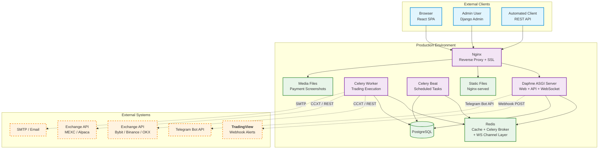

# Software Architecture — Torgovo2 Trading Bot Platform

> Hexagonal (ports & adapters) architecture with a Django monolith backend, Celery for async trading, and a React frontend.

---

## High-Level Layer Diagram

```mermaid
graph TB
    subgraph "PRESENTATION LAYER"
        DA[Django Admin<br/>apps/*/admin.py]
        API[DRF API Views<br/>apps/*/views.py]
        WH[Webhook Endpoint<br/>apps/webhooks/]
        UI[React Frontend<br/>frontend/src/]
    end

    subgraph "SERVICES LAYER"
        BES[BotExecutorService<br/>services/bot_executor.py]
        QFS[QuantumAIFundService<br/>services/quantum_ai_fund.py]
        SS[SubscriptionService<br/>services/subscription_service.py]
        TS[TelegramService<br/>core/telegram_service.py]
    end

    subgraph "TRADING ENGINE"
        RUN[run_bot / stop_bot<br/>engines/execution.py]
        BE[BotEngine<br/>engines/bot_engine.py]
        BEQ[BotExecutor<br/>engines/execution.py]
    end

    subgraph "STRATEGIES LAYER (Pure Python)"
        BS[BaseStrategy &#171;ABC&#187;<br/>strategies/base.py]
        QAS[QuantumAIStrategy<br/>strategies/quantum_ai.py]
        GTS[GridTradingStrategy<br/>strategies/grid_trading.py]
        MS[MartingaleStrategy<br/>strategies/martingale.py]
        WAS[WebhookAlertStrategy<br/>strategies/webhook_alerts.py]
    end

    subgraph "ADAPTERS LAYER (Ports)"
        BA[BaseAdapter &#171;ABC&#187;<br/>exchanges/base_adapter.py]
        BYA[BybitAdapter]
        BIA[BinanceAdapter]
        OKA[OKXAdapter]
        MXA[MEXCAdapter]
        APA[AlpacaAdapter]
    end

    subgraph "CCXT (Exchange Abstraction)"
        CCXT[ccxt library]
    end

    subgraph "DATA LAYER (Django Models)"
        MODELS[40+ Models across 10 apps]
        DB[(PostgreSQL)]
        REDIS[(Redis<br/>Cache + Channel Layer)]
    end

    subgraph "INFRASTRUCTURE"
        CELERY[Celery Worker]
        CELERY_BEAT[Celery Beat - Scheduler]
        ASGI[Daphne ASGI Server]
        NGINX[Nginx Reverse Proxy]
    end

    %% PRESENTATION -> SERVICES
    DA --> BES
    DA --> QFS
    API --> BES
    API --> QFS
    API --> SS
    WH --> BES
    UI --> API

    %% SERVICES -> TRADING ENGINE
    BES --> RUN

    %% TRADING ENGINE -> STRATEGIES
    BE --> BS
    BE --> QAS
    BEQ --> BS

    %% TRADING ENGINE -> ADAPTERS
    BE --> BA
    BEQ --> BA

    %% ADAPTERS -> CCXT
    BYA --> CCXT
    BIA --> CCXT
    OKA --> CCXT
    MXA --> CCXT
    APA --> CCXT

    %% CELERY -> TRADING ENGINE
    CELERY --> RUN
    CELERY_BEAT --> QFS

    %% DATA LAYER
    MODELS --> DB
    MODELS -.-> REDIS

    %% STYLES
    classDef pure fill:#e1f5fe,stroke:#0288d1,stroke-width:2px
    classDef django fill:#fff3e0,stroke:#f57c00,stroke-width:2px
    classDef infrastructure fill:#f3e5f5,stroke:#7b1fa2,stroke-width:2px
    classDef data fill:#e8f5e9,stroke:#388e3c,stroke-width:2px
    classDef engine fill:#fce4ec,stroke:#c62828,stroke-width:2px

    class BS,QAS,GTS,MS,WAS pure
    class BA,BYA,BIA,OKA,MXA,APA pure
    class DA,API,WH,UI,MODELS django
    class CELERY,CELERY_BEAT,ASGI,NGINX infrastructure
    class DB,REDIS data
    class RUN,BE,BEQ engine
```



---

## Package Dependency Graph (Django Apps)

```mermaid
graph TB
    subgraph config
        urls[config/urls.py]
        settings[config/settings/]
    end

    subgraph core
        CM[core/models.py<br/>TimeStampedModel<br/>SoftDeleteModel<br/>AuditLog]
        CU[core/utils.py<br/>encrypt/decrypt API keys]
        CT[core/telegram_service.py]
        CP[core/permissions.py]
    end

    subgraph users
        UM[users/models.py<br/>CustomUser, UserBalance]
        UV[users/views.py]
    end

    subgraph exchanges_app
        EM[exchanges/models.py<br/>Exchange, ExchangeCredentials<br/>TradingPair]
        EV[exchanges/views.py]
    end

    subgraph bots
        BM[bots/models.py<br/>SignalBot, GridBot, MartingaleBot<br/>QuantumAIFund, QuantumAIBot<br/>Order, Indicator, PairConfig]
        BA[bots/admin.py<br/>All admin registrations]
        BV[bots/views.py]
    end

    subgraph trading
        TENG[engines/<br/>bot_engine.py, execution.py]
        TSTRAT[strategies/<br/>base.py, quantum_ai.py<br/>grid_trading.py, martingale.py]
        TEX[exchanges/<br/>base_adapter.py, bybit.py<br/>binance.py, okx.py, mexc.py]
        TV[trading/views.py]
    end

    subgraph payments
        PM[payments/models.py<br/>BotSubscription, BotSubscriptionPlan<br/>PaymentTransaction, WithdrawalRequest]
        PV[payments/views.py]
    end

    subgraph subscriptions
        SM[subscriptions/models.py<br/>TelegramSignalPlan, TelegramChannel<br/>TradingSignal, SignalResult]
        SV[subscriptions/views.py]
    end

    subgraph services
        BSERV[services/bot_executor.py]
        QFSERV[services/quantum_ai_fund.py]
        SSERV[services/subscription_service.py]
    end

    subgraph webhooks
        WM[webhooks/models.py<br/>WebhookLog]
        WV[webhooks/views.py]
    end

    subgraph investments
        IM[investments/models.py<br/>BotBase, GridBot<br/>QuantumAIBot, Order]
        IV[investments/views.py]
    end

    subgraph referrals
        RM[referrals/models.py<br/>Referral]
        RV[referrals/views.py]
    end

    %% URL routing
    urls --> BV
    urls --> EV
    urls --> UV
    urls --> TV
    urls --> PV
    urls --> SV
    urls --> WV
    urls --> IV
    urls --> RV

    %% Core dependency: almost everything depends on core & users
    BM --> CM
    BM --> CU
    BM --> UM
    TENG --> BM
    TENG --> CU
    TENG --> TSTRAT
    TENG --> TEX
    BSERV --> BM
    BSERV --> TENG
    BSERV --> UM
    QFSERV --> BM
    PM --> CM
    PM --> UM
    SM --> UM
    SM --> PM
    WV --> BM
    WV --> UM

    %% Services depend on models
    BSERV --> BM
    BSERV --> PM
    QFSERV --> BM
    SSERV --> PM
    SSERV --> SM

    %% Admin registrations
    BA --> BM
    BA --> PM
    BA --> QFSERV
    BA --> TENG

    %% Cross-app refs
    BM --> PM  % BotSubscription FK %
    BM --> EM  % exchange_name references %
    TENG --> EM % ExchangeCredentials %

    STYLE_DEF fill:#e3f2fd,stroke:#1565c0
    STYLE_PURE fill:#fce4ec,stroke:#c62828
    style urls fill:#fff9c4,stroke:#f9a825
    style core fill:#e8f5e9,stroke:#2e7d32
    style users fill:#e8f5e9,stroke:#2e7d32
    style bots fill:#e3f2fd,stroke:#1565c0
    style trading fill:#fce4ec,stroke:#c62828
    style services fill:#f3e5f5,stroke:#7b1fa2
    style payments fill:#fff3e0,stroke:#f57c00
    style subscriptions fill:#fff3e0,stroke:#f57c00
    style webhooks fill:#f1f8e9,stroke:#689f38
    style investments fill:#f1f8e9,stroke:#689f38
    style referrals fill:#f1f8e9,stroke:#689f38
```

---

## Deployment Architecture



---

## Bot Execution Architecture (ports & adapters)

```mermaid
graph TB
    subgraph "Entry Points"
        CELERY_TASK[Celery Task<br/>run_trading_bot.delay()]
        ADMIN_START[Admin Action<br/>Start Bot]
        WEBHOOK[Webhook POST<br/>TradingView Alert]
    end

    subgraph "Orchestrator"
        RUN_BOT[run_bot(bot_id, bot_type)]
        STOP_BOT[stop_bot(bot_id, bot_type)]
        RUNNING_BOTS[_running_bots Set<br/>Thread-safe lock]
        RUNNING_ENGINES[_running_engines Dict<br/>Thread-safe lock]
    end

    subgraph "Engine Factory"
        BOT_ENGINE[BotEngine<br/>Legacy-compatible execution<br/>startBot / stopBot]
        BOT_EXECUTOR[BotExecutor<br/>Strategy + Adapter<br/>run_once / run_loop]
    end

    subgraph "Strategy (Port)"
        BS[&#171;interface&#187; BaseStrategy<br/>+execute(market_data, account_info, position) -> Signal]
        QAS[QuantumAIStrategy]
        GTS[GridTradingStrategy]
        MS[MartingaleStrategy]
    end

    subgraph "Adapter (Port)"
        BA[&#171;interface&#187; BaseAdapter<br/>+fetch_ticker, create_order, ...]
        BYA[BybitAdapter]
        BIA[BinanceAdapter]
        OKA[OKXAdapter]
        MXA[MEXCAdapter]
    end

    subgraph "Exchange (CCXT)"
        CCXT[ccxt.Exchange]
    end

    subgraph "Data Storage"
        DB_MODELS[Saves to Django Models<br/>Order, Bot.is_running]
        CREDS[ExchangeCredentials<br/>Decrypted on use]
    end

    %% Flow
    CELERY_TASK --> RUN_BOT
    ADMIN_START --> RUN_BOT
    WEBHOOK --> BOT_EXECUTOR
    RUN_BOT --> BOT_ENGINE
    RUN_BOT --> BOT_EXECUTOR
    RUN_BOT --> RUNNING_BOTS
    RUN_BOT --> STOP_BOT
    STOP_BOT --> RUNNING_ENGINES

    BOT_ENGINE --> BS
    BOT_ENGINE --> BA
    BOT_EXECUTOR --> BS
    BOT_EXECUTOR --> BA

    QAS -.->|implements| BS
    GTS -.->|implements| BS
    MS -.->|implements| BS
    BYA -.->|implements| BA
    BIA -.->|implements| BA
    OKA -.->|implements| BA
    MXA -.->|implements| BA

    BA --> CCXT
    BOT_ENGINE --> DB_MODELS
    BOT_ENGINE --> CREDS

    classDef entry fill:#e1f5fe,stroke:#0288d1,stroke-width:2px
    classDef orch fill:#fce4ec,stroke:#c62828,stroke-width:2px
    classDef engine fill:#f3e5f5,stroke:#7b1fa2,stroke-width:2px
    classDef port fill:#fff3e0,stroke:#f57c00,stroke-width:2px
    classDef adapter fill:#e8f5e9,stroke:#388e3c,stroke-width:2px

    class CELERY_TASK,ADMIN_START,WEBHOOK entry
    class RUN_BOT,STOP_BOT,RUNNING_BOTS,RUNNING_ENGINES orch
    class BOT_ENGINE,BOT_EXECUTOR engine
    class BS,QAS,GTS,MS port
    class BA,BYA,BIA,OKA,MXA adapter
```

---

## Design Principles

| Principle | Implementation |
|---|---|
| **Ports & Adapters** | `BaseStrategy` and `BaseAdapter` are pure Python ABCs with no Django imports. Exchange and strategy implementations are swappable. |
| **Separation of Concerns** | Django models (data) never call exchange APIs. Strategies (pure logic) never import Django. Engines bridge the two. |
| **Encrypted Secrets** | API keys encrypted at rest (`core.utils`), decrypted only in-memory at trading time. |
| **Concurrency Guard** | In-process `_running_bots` set + DB `is_running` flag prevent duplicate bot execution. Threading locks for thread safety. |
| **Soft Delete** | All production models use `SoftDeleteModel` — no data is ever permanently lost. |
| **Celery for Async** | Trading execution runs in Celery workers, not the web process, preventing API timeout and allowing horizontal scaling. |
