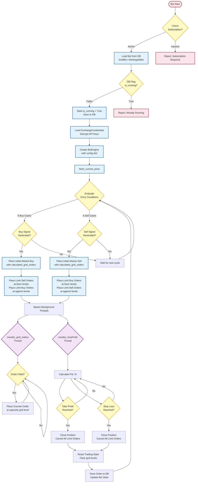
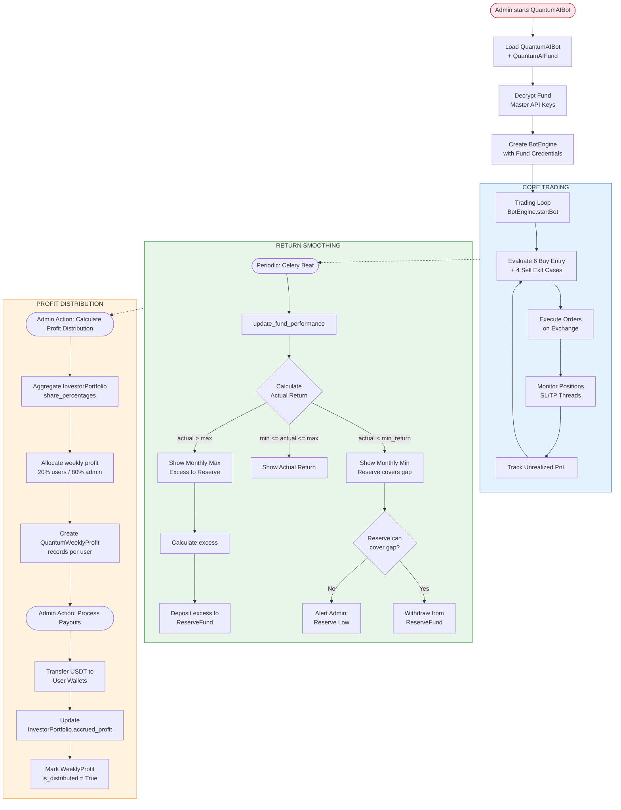
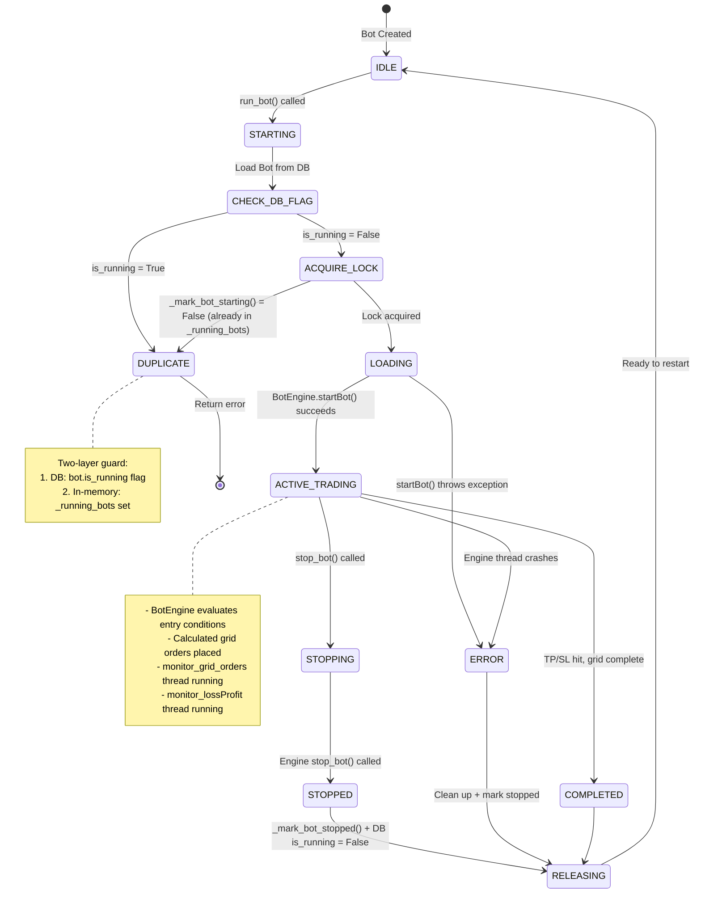

# Flow Charts — Torgovo2 Trading Lifecycle

---

## 1. Grid / Martingale Bot Lifecycle (Full Cycle)



---

## 2. Quantum AI Fund Flow (Smoothing + Reserve)



---

## 3. Signal Bot (TradingView Webhook) Flow

```mermaid
flowchart LR
    subgraph "External"
        TV[TradingView<br/>Strategy Alert]
    end

    subgraph "Webhook Reception"
        POST[POST /api/webhooks/custombot/]
        AUTH[Authenticate via<br/>bot_id + secret_key]
        PARSE[Parse Payload:<br/>side, qty, price, pair]
    end

    subgraph "Execution"
        FIND_BOT[Find SignalBot by webhook_url]
        CHECK_LIMIT{Signal limit<br/>remaining?}
        LOAD_CREDS[Load ExchangeCredentials<br/>Decrypt Keys]
        DECIDE_ENGINE{Use BotEngine<br/>or raw CCXT?}
    end

    subgraph "BotEngine Path"
        BE_PATH[Create BotEngine<br/>execute_once]
        BE_ORDER[Place Order via<br/>Adapter Layer]
    end

    subgraph "Raw CCXT Path (legacy)"
        RAW_PATH[Create CCXT Order<br/>Direct on Exchange]
    end

    subgraph "Post-Execution"
        LOG_ORDER[Log to Order Model<br/>FK = SignalBot]
        UPDATE_BOT[Update SignalBot:<br/>total_trades++, profit/loss]
        CHECK_SIGNAL{Check Signal Count}
        UPDATE_SIGNAL[Increment<br/>signals_used_this_month]
        RESPOND[Return JSON Response]
    end

    TV --> POST
    POST --> AUTH
    AUTH -->|Valid| PARSE
    AUTH -->|Invalid| REJECT[401 Unauthorized]
    PARSE --> FIND_BOT
    FIND_BOT --> CHECK_LIMIT
    CHECK_LIMIT -->|Yes| LOAD_CREDS
    CHECK_LIMIT -->|No / Rate Limited| RATE_LIMIT[429 Rate Limited]
    LOAD_CREDS --> DECIDE_ENGINE

    DECIDE_ENGINE -->|Grid/Martingale config| BE_PATH
    DECIDE_ENGINE -->|Simple signal| RAW_PATH

    BE_PATH --> BE_ORDER
    BE_ORDER --> LOG_ORDER
    RAW_PATH --> LOG_ORDER

    LOG_ORDER --> UPDATE_BOT
    UPDATE_BOT --> CHECK_SIGNAL
    CHECK_SIGNAL --> UPDATE_SIGNAL
    UPDATE_SIGNAL --> RESPOND

    classDef ext fill:#fff3e0,stroke:#f57c00,stroke-width:2px
    classDef webhook fill:#e3f2fd,stroke:#1565c0,stroke-width:2px
    classDef decision fill:#fff9c4,stroke:#f9a825,stroke-width:2px
    classDef execution fill:#fce4ec,stroke:#c62828,stroke-width:2px
    classDef post fill:#e8f5e9,stroke:#388e3c,stroke-width:2px

    class TV ext
    class POST,AUTH,PARSE,FIND_BOT webhook
    class CHECK_LIMIT,DECIDE_ENGINE,CHECK_SIGNAL decision
    class BE_PATH,RAW_PATH,BE_ORDER execution
    class LOG_ORDER,UPDATE_BOT,UPDATE_SIGNAL,RESPOND post
```



---

## 4. User Onboarding + Bot Creation Flow

```mermaid
flowchart TB
    USER([User]) --> REGISTER[Register<br/>POST /api/auth/register/]
    REGISTER --> VERIFY_EMAIL{Email<br/>Verified?}
    VERIFY_EMAIL -->|No| SEND_CODE[Send Verification Code]
    SEND_CODE --> VERIFY[Verify Email]
    VERIFY --> VERIFY_EMAIL
    VERIFY_EMAIL -->|Yes| LOGIN[Login<br/>JWT Token Issued]

    LOGIN --> BROWSE_PLANS{Choose<br/>Subscription Plan}
    BROWSE_PLANS --> PURCHASE[Purchase BotSubscriptionPlan]
    PURCHASE --> UPLOAD_PAYMENT[Upload Payment Proof<br/>Screenshot]
    UPLOAD_PAYMENT --> PENDING_APPROVAL{Admin<br/>Approves?}

    PENDING_APPROVAL -->|Yes| SUB_ACTIVE[BotSubscription = Active]
    PENDING_APPROVAL -->|No| SUB_REJECTED[BotSubscription = Rejected]

    SUB_ACTIVE --> CHOOSE_BOT_TYPE{Choose Bot Type}
    CHOOSE_BOT_TYPE -->|TradingView Alerts| CREATE_SIGNAL[Create SignalBot<br/>Set webhook_url + trading_pair]
    CHOOSE_BOT_TYPE -->|Grid Trading| CREATE_GRID[Create GridBot<br/>Set levels, qty, TP/SL]
    CHOOSE_BOT_TYPE -->|Martingale| CREATE_MARTINGALE[Create MartingaleBot<br/>Set multiplier, levels]
    CHOOSE_BOT_TYPE -->|Quantum AI| CREATE_QAI[InvestorDeposit<br/>Deposit to Fund Wallet]

    CREATE_SIGNAL --> CONFIGURE[Configure via API]
    CREATE_GRID --> CONFIGURE
    CREATE_MARTINGALE --> CONFIGURE

    CONFIGURE --> START_BOT{Start Bot?}
    START_BOT -->|Admin or API| TRADING_START[run_bot(bot_id, type)]
    TRADING_START --> ACTIVE_TRADING[Trading Active]

    ACTIVE_TRADING --> MONITOR_DASHBOARD[Monitor via Dashboard<br/>Order History, PnL]
    MONITOR_DASHBOARD --> STOP_BOT{Stop Bot?}
    STOP_BOT -->|Yes| BOT_STOP[stop_bot(bot_id)]
    STOP_BOT -->|No| ACTIVE_TRADING

    BOT_STOP --> ARCHIVE[Bot Stopped<br/>Can Restart Later]

    classDef user fill:#e1f5fe,stroke:#0288d1,stroke-width:2px
    classDef auth fill:#f3e5f5,stroke:#7b1fa2,stroke-width:2px
    classDef decision fill:#fff9c4,stroke:#f9a825,stroke-width:2px
    classDef bot fill:#e8f5e9,stroke:#388e3c,stroke-width:2px
    classDef trading fill:#fce4ec,stroke:#c62828,stroke-width:2px

    class USER user
    class REGISTER,SEND_CODE,VERIFY,LOGIN auth
    class VERIFY_EMAIL,BROWSE_PLANS,PENDING_APPROVAL,CHOOSE_BOT_TYPE,START_BOT,STOP_BOT decision
    class PURCHASE,UPLOAD_PAYMENT,SUB_ACTIVE,SUB_REJECTED,CONFIGURE bot
    class TRADING_START,ACTIVE_TRADING,MONITOR_DASHBOARD trading
```

---

## 5. Concurrent Bot Execution State Machine


