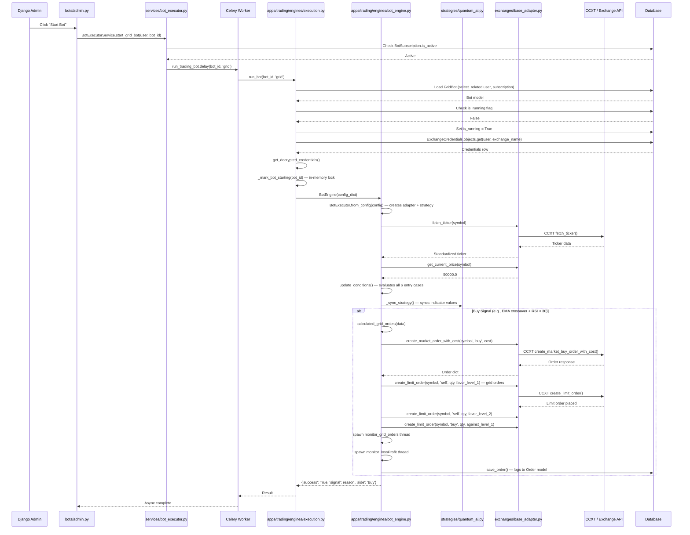
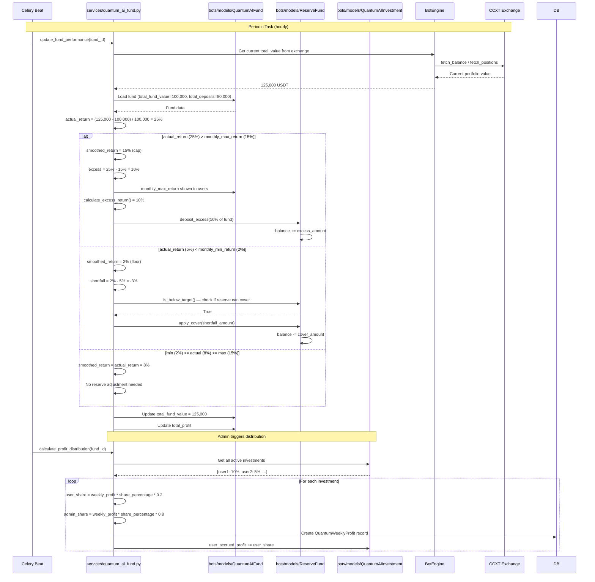
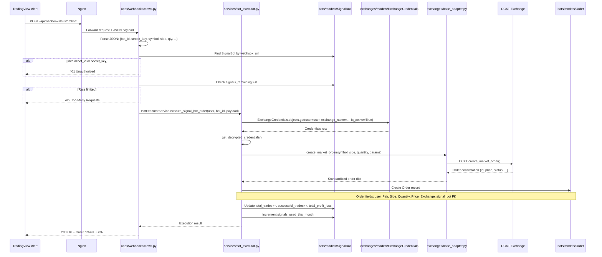
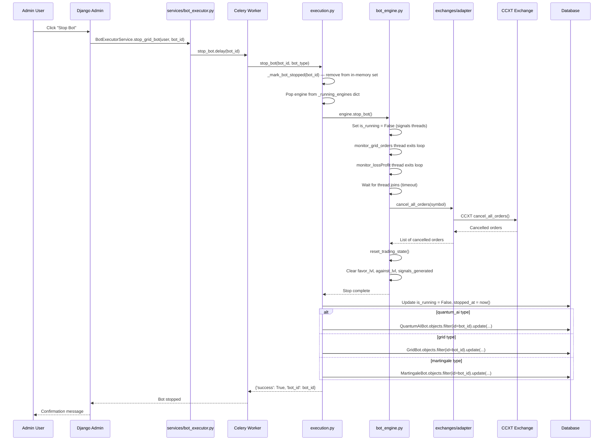
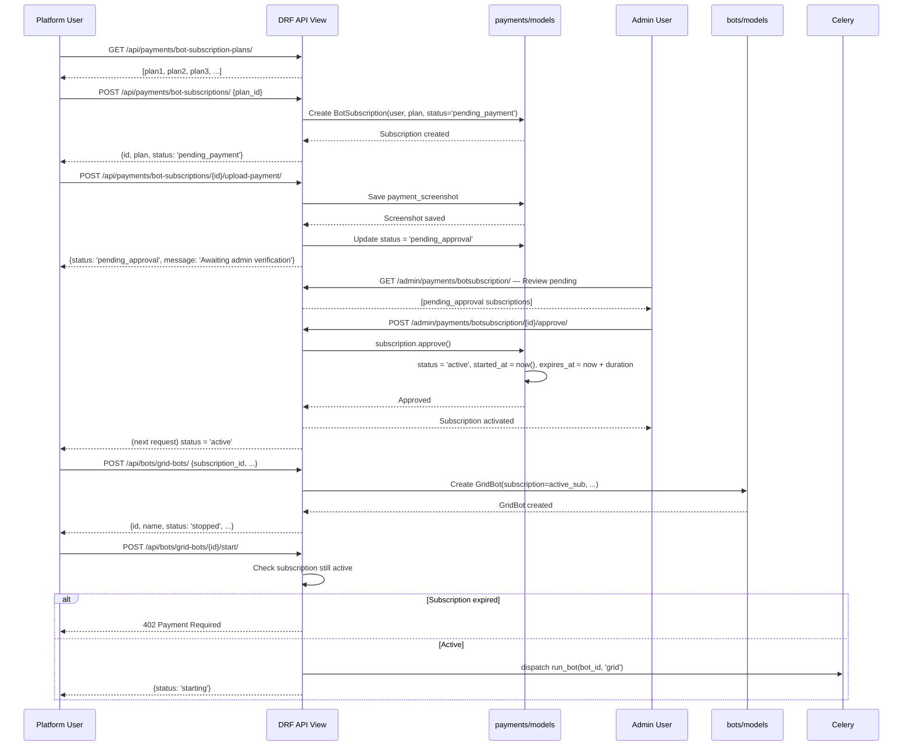

# Sequence Diagrams — Torgovo2 Key Interaction Flows

---

## 1. Grid/Martingale Bot — Start and Trade Lifecycle

---

## 2. Quantum AI Fund — Performance Smoothing

---

## 3. TradingView Webhook → Signal Bot Execution

---

## 4. Bot Stop + Resource Cleanup

---

## 5. Subscription Purchase → Bot Activation

