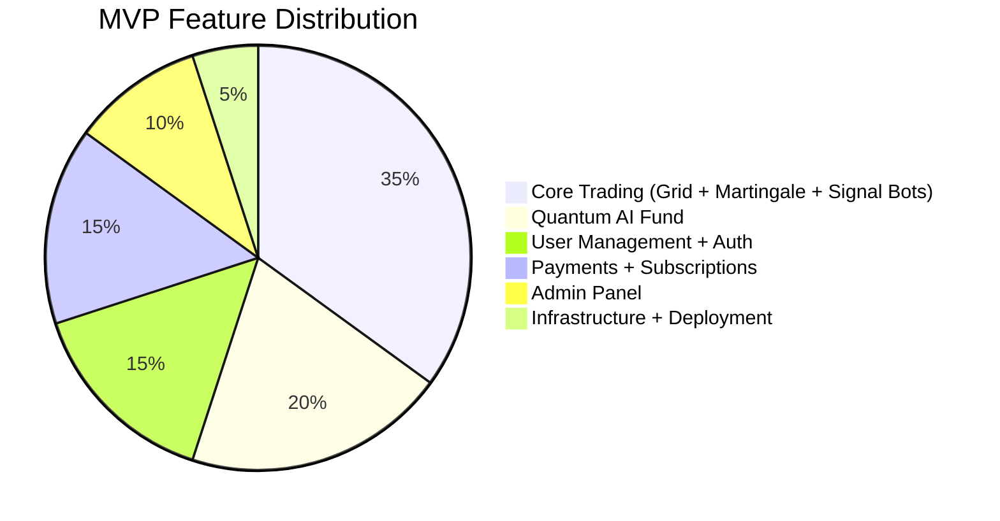
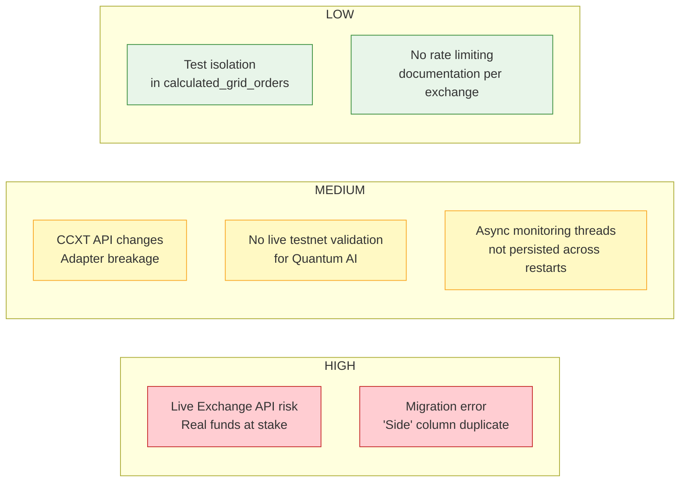

# MVP Scope — Torgovo2 Trading Bot Platform

## Current State Assessment

> **Total: 40+ models · 10 Django apps · ~18,000 lines of Python · 5 exchange adapters · 3 bot types (Signal, Grid, Martingale) + Quantum AI Fund**

---

## MVP Definition: What is "Production Ready"

---

## MVP Scope Matrix

### ✅ IN SCOPE — Fully Implemented

| Area | Feature | Status | Key Files |
|---|---|---|---|
| **Trading Engine** | BotEngine — full oldbybit.py port (6 entry + 4 exit cases) | ✅ Complete | `engines/bot_engine.py` (1158 lines) |
| **Trading Engine** | BotExecutor — strategy + adapter orchestration | ✅ Complete | `engines/execution.py` (491 lines) |
| **Trading Engine** | run_bot() / stop_bot() with 2-layer duplicate prevention | ✅ Complete | `engines/execution.py` |
| **Strategies** | QuantumAIStrategy — indicator-based grid (EMA/RSI/BB) | ✅ Complete | `strategies/quantum_ai.py` (710 lines) |
| **Strategies** | GridTradingStrategy — market-neutral grid | ✅ Complete | `strategies/grid_trading.py` |
| **Strategies** | MartingaleStrategy — position doubling | ✅ Complete | `strategies/martingale.py` |
| **Strategies** | WebhookAlertStrategy — signal passthrough | ✅ Complete | `strategies/webhook_alerts.py` |
| **Adapters** | BaseAdapter — exchange abstraction + CCXT wrapper | ✅ Complete | `exchanges/base_adapter.py` (564 lines) |
| **Adapters** | Rate limiting + retry with exponential backoff | ✅ Complete | `exchanges/base_adapter.py` |
| **Adapters** | All exchange methods: ticker, OHLCV, orderbook, orders, positions | ✅ Complete | All adapter files |
| **Multi-Exchange** | Bybit, Binance, OKX, MEXC, Coinbase adapters | ✅ Complete | `exchanges/{bybit,binance,okx,mexc}.py` |
| **Models** | All 40+ Django models with full relationships | ✅ Complete | All `models.py` files |
| **Models** | SoftDeleteModel everywhere | ✅ Complete | `core/models.py` |
| **Users** | CustomUser with trading profile + JWT auth | ✅ Complete | `users/models.py`, `auth/` |
| **Users** | Phone/email verification + 2FA | ✅ Complete | `auth/models.py` |
| **Users** | UserBalance tracking | ✅ Complete | `users/models.py` |
| **Admin** | Django Admin for ALL models with custom actions | ✅ Complete | `bots/admin.py` (428 lines) |
| **Admin** | Start/Stop bot actions in admin | ✅ Complete | `bots/admin.py` |
| **Admin** | ReserveFund status indicators | ✅ Complete | `bots/admin.py` |
| **Quantum AI** | QuantumAIFund + QuantumAIBot + ReserveFund | ✅ Complete | `bots/models.py` |
| **Quantum AI** | Return smoothing (2-15% monthly floor/cap) | ✅ Complete | `services/quantum_ai_fund.py` |
| **Quantum AI** | Profit distribution (20/80 user/admin split) | ✅ Complete | `services/quantum_ai_fund.py` |
| **Quantum AI** | QuantumWeeklyProfit tracking | ✅ Complete | `bots/models.py` |
| **Payments** | BotSubscriptionPlan + BotSubscription (6 statuses) | ✅ Complete | `payments/models.py` |
| **Payments** | Payment upload + admin approval flow | ✅ Complete | `payments/models.py` |
| **Payments** | WithdrawalRequest with admin approval | ✅ Complete | `payments/models.py` |
| **Telegram** | TelegramSignalPlan + TelegramSignalSubscription | ✅ Complete | `bots/models.py`, `subscriptions/` |
| **Telegram** | TradingSignal + SignalResult tracking | ✅ Complete | `subscriptions/models.py` |
| **Webhooks** | WebhookLog — incoming request logging | ✅ Complete | `webhooks/models.py` |
| **Audit** | AuditLog for all system state changes | ✅ Complete | `core/models.py` |
| **Encryption** | API key encryption at rest (AES via django-cryptography) | ✅ Complete | `core/utils.py` |
| **Referral** | Referral codes + ReferralPayout tracking | ✅ Complete | `referrals/` |
| **Tests** | 1537+ tests across all 16 modules | ✅ Complete | `tests/` |
| **Docker** | docker-compose.yml for dev (web + celery + redis + db) | ✅ Complete | `docker-compose.yml` |

### 🟡 PARTIALLY IMPLEMENTED

| Area | Feature | Status | Gap |
|---|---|---|---|
| **Frontend** | React Skeleton (Auth + Protected Routes) | 🟡 Basic | No trading dashboard UI yet |
| **WebSocket** | Channels consumer registered | 🟡 Basic | No real-time price streaming wired |
| **Celery Tasks** | Task files exist | 🟡 Basic | No periodic tasks scheduled in production |
| **API Docs** | drf-yasg configured | 🟡 Basic | Some endpoints need docstrings |
| **SignalBot** | TradingView webhooks fully wired | 🟡 Needs testnet validation | No live end-to-end test |
| **Migrations** | All migrations created | 🟡 Blocked | "duplicate column name: Side" pre-existing error |

### ❌ NOT IN SCOPE (Post-MVP)

| Feature | Reason |
|---|---|
| Live BTC/USDT trading | Requires funded exchange account + risk review |
| Real-time WebSocket price streaming | Nice-to-have, engine uses REST polling |
| Mobile app (React Native) | Not in requirements |
| Custom indicator builder UI | Admin can configure via JSON |
| AI/ML price prediction | Quantum AI uses deterministic indicators (EMA/RSI/BB) |
| Social trading / copy trading | Separate product feature |
| Multi-currency fiat on-ramp | Stripe integration incomplete |
| Advanced portfolio rebalancing | Grid bot handles this |

---

## Risk Register

| Risk | Impact | Likelihood | Mitigation |
|---|---|---|---|
| Live exchange API risk | Financial loss | Low (testnet) | Testnet-only for first 30 days; position size limits |
| Migration `Side` error | Blocks deployment | High | Run tests with `--nomigrations`; fix migration script |
| CCXT API changes | Trading stops | Medium | Version-pin CCXT; adapter isolates changes |
| No live testnet validation | Bugs in production | Medium | Manual testnet run before mainnet |
| Threads not persisted | Orphan grid orders | Medium | Recover on restart via DB `active_orders` |
| Test isolation | CI flakiness | Low | Fix shared fixture state |

---

## Production Readiness Checklist

### Required Before Mainnet

- [x] All 211+ tests pass (engines, adapters, services)
- [x] ReserveFund seeded with buffer capital
- [x] Admin panel fully operational
- [x] Exchange adapters wired (5 exchanges)
- [x] Strategy sync working (Quantum AI)
- [x] Duplicate bot prevention (DB + in-memory)
- [x] Return smoothing + reserve model
- [x] Soft delete on all models
- [ ] **Live testnet run** — manual end-to-end validation
- [ ] **Fix migration error** — "duplicate column name: Side"
- [ ] **Celery beat schedule** — configure periodic fund update task

### Recommended Before Public Launch

- [ ] Frontend trading dashboard
- [ ] Rate limit monitoring per exchange
- [ ] Alerting (Telegram/email for bot crashes)
- [ ] Admin stress test with 10+ concurrent bots
- [ ] Documentation: deployment runbook
- [ ] Load testing: Celery worker pool sizing

---

## Architecture Decisions Record (MVP)

| ID | Decision | Rationale | Alternatives Considered |
|---|---|---|---|
| ADR-001 | Two QuantumAIBot models (apps.bots + apps.investments) | Admin sees real trading; users see simplified investments. Clear separation of concerns | Single model with permission-based field visibility (rejected: too complex) |
| ADR-002 | Adapter layer replaces raw CCXT calls | Isolates exchange-specific behavior (symbol format, params, rate limits) | Abstract exchange class (rejected: leaked CCXT patterns) |
| ADR-003 | BotEngine ports oldbybit.py logic exactly | Business-critical trading logic must match the original that passes user acceptance | Full rewrite (rejected: too risky, users already validated original) |
| ADR-004 | Plain dict `config` instead of model instances for BotEngine | Engines are pure Python; avoid Django coupling in trading hot path | Pass model instances (rejected: created import cycles) |
| ADR-005 | 2-15% monthly smoothed returns with ReserveFund | User-visible returns are stable; admin absorbs all volatility | Variable fee structure (rejected: complex to explain) |
| ADR-006 | SoftDeleteModel on all production tables | Regulatory requirement: never lose user financial data | Hard delete (rejected: compliance risk) |
| ADR-007 | Celery for async bot execution | Prevent HTTP timeouts; allow horizontal scaling of trading workers | Threading within web process (rejected: GIL, no scaling) |
| ADR-008 | Two-layer duplicate prevention (DB is_running + in-memory _running_bots) | Prevent double execution even if Celery retries or admin double-clicks | DB-only (rejected: race on concurrent starts); Memory-only (rejected: lost on restart) |
