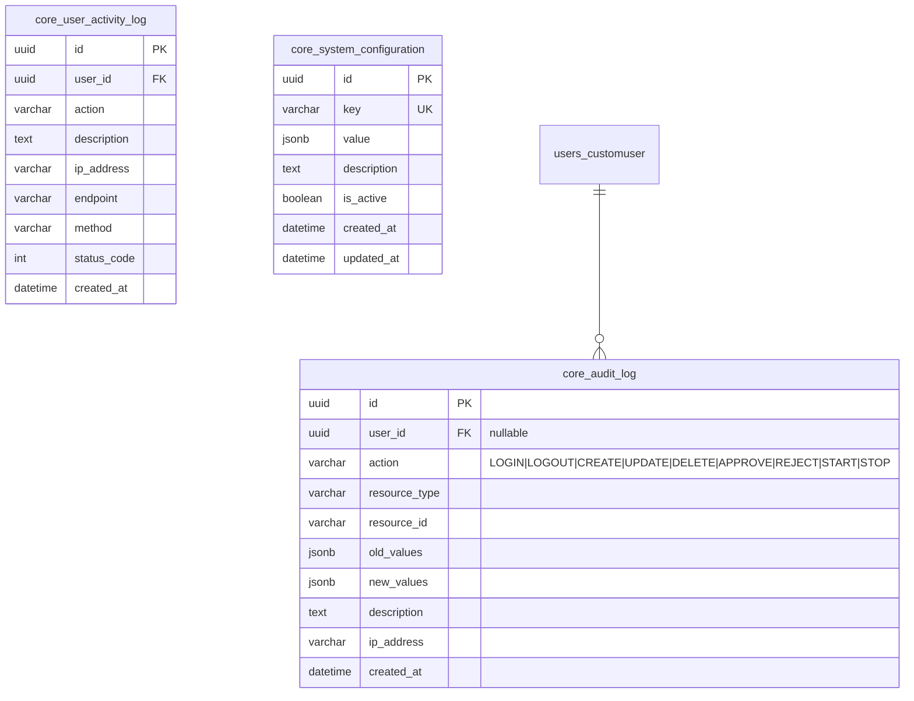
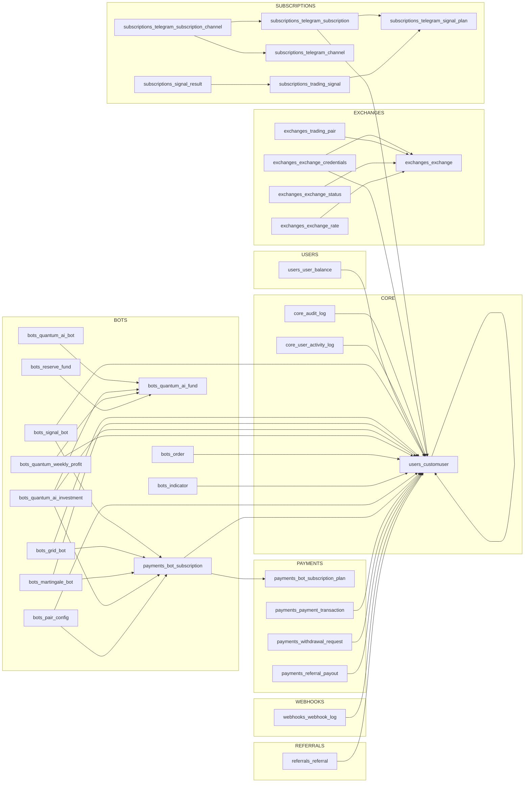

# Database Entity-Relationship Diagram

> Physical schema: PostgreSQL with UUID PKs, all tables listed with column types, constraints, and indexes.

---

## Legend

```
TABLE_NAME
├── PK  column_name   TYPE        CONSTRAINT / DEFAULT
├── FK  column_name   → TABLE     ON DELETE
├── UX  column_name               UNIQUE
├── IX  column_name               INDEX
└── col column_name   TYPE        DEFAULT / NULLABLE / CHOICES
```

---

## 1. Core Foundation (`core_`)



---

## 2. Users & Auth (`users_`, `auth_`)

```mermaid
erDiagram
    users_customuser {
        uuid id PK
        varchar password
        datetime last_login
        boolean is_superuser
        varchar email UK "USERNAME_FIELD"
        varchar subscription_plan "free|basic|premium|enterprise"
        int max_bots_allowed
        boolean demo_trading_enabled
        varchar risk_tolerance "conservative|moderate|aggressive"
        boolean email_notifications
        boolean sms_notifications
        boolean push_notifications
        int total_trades_executed
        decimal total_volume_traded
        decimal total_profit_loss
        uuid default_exchange_id FK "nullable"
        boolean auto_compound_profits
        varchar compound_frequency "daily|weekly|monthly"
        varchar phone_number
        boolean is_email_verified
        boolean is_phone_verified
        boolean two_factor_enabled
        varchar timezone
        varchar referral_code UK
        uuid referred_by_id FK "nullable, self-ref"
        datetime created_at
        datetime updated_at
    }

    users_user_balance {
        uuid id PK
        uuid user_id FK
        varchar currency
        decimal available
        decimal hold
        UX "user + currency"
    }

    users_customuser ||--o{ users_user_balance : ""
    users_customuser ||--o| users_customuser : referred_by
```

---

## 3. Exchange & Market Data (`exchanges_`)

```mermaid
erDiagram
    exchanges_exchange {
        uuid id PK
        varchar name UK
        varchar display_name
        varchar api_base_url
        varchar websocket_url
        boolean is_active
        boolean supports_testnet
        jsonb supported_features
        int rate_limit_per_minute
        jsonb fee_rates
        datetime created_at
        datetime updated_at
    }

    exchanges_exchange_credentials {
        uuid id PK
        uuid user_id FK
        varchar exchange_name FK
        text api_key "encrypted"
        text secret_key "encrypted"
        text passphrase "encrypted, nullable"
        boolean is_active
        boolean is_testnet
        jsonb permissions
        varchar verification_status
        boolean trading_enabled
        boolean withdrawal_enabled
        boolean is_deleted
        datetime deleted_at
        UX "user + exchange_name"
    }

    exchanges_trading_pair {
        uuid id PK
        varchar exchange_name FK
        varchar symbol
        varchar base_asset
        varchar quote_asset
        boolean is_active
        decimal min_order_size
        decimal max_order_size
        int price_precision
        int quantity_precision
        decimal maker_fee
        decimal taker_fee
        decimal min_notional
        UX "exchange_name + symbol"
    }

    exchanges_exchange_status {
        uuid id PK
        varchar exchange_name FK
        varchar status "online|degraded|offline|maintenance"
        int response_time_ms
        text error_message "nullable"
        jsonb api_limits
        datetime created_at
    }

    exchanges_supported_blockchain {
        uuid id PK
        varchar name UK
        varchar blockchain_code UK
        varchar native_coin
        varchar explorer_url
        int confirmation_blocks
        varchar transaction_fee_type
        decimal average_fee
        boolean is_active
        datetime created_at
    }

    exchanges_exchange_rate {
        uuid id PK
        varchar from_currency
        varchar to_currency
        decimal rate
        varchar exchange_name
        varchar source
        datetime timestamp
        UX "from_currency + to_currency + exchange_name"
    }

    exchanges_exchange_credentials }o--|| users_customuser : ""
    exchanges_exchange_credentials }o--|| exchanges_exchange : exchange_name
    exchanges_trading_pair }o--|| exchanges_exchange : exchange_name
    exchanges_exchange_status }o--|| exchanges_exchange : exchange_name
    exchanges_exchange_rate }o--|| exchanges_exchange : exchange_name
```

---

## 4. Bot Domain — Core (`bots_`)

```mermaid
erDiagram
    bots_signal_bot {
        uuid id PK
        uuid user_id FK
        uuid subscription_id FK
        uuid bot_id UK
        varchar bot_name
        varchar webhook_url UK
        varchar secret_key
        varchar exchange_name
        varchar market_type "spot|futures"
        varchar trading_pair
        decimal default_amount
        boolean use_tradingView_position_size
        decimal take_profit_percent
        decimal stop_loss_percent
        boolean is_active
        int signals_used_this_month
        int signal_limit
        int total_trades
        int successful_trades
        decimal total_profit_loss
        boolean is_deleted
        datetime deleted_at
        IX "webhook_url"
        IX "user_id"
    }

    bots_grid_bot {
        uuid id PK
        uuid user_id FK
        uuid subscription_id FK
        varchar bot_name
        varchar exchange_name
        varchar trading_pair
        decimal initial_amount
        decimal base_amount
        int favor_levels "CHECK 1-50"
        int against_levels "CHECK 1-50"
        decimal level_spacing_percent
        decimal favor_level_qty
        decimal against_level_qty
        decimal favor_level_difference
        decimal against_level_difference
        varchar amount_type "base|quote"
        decimal take_profit_percent
        decimal stop_loss_percent
        boolean is_running
        jsonb active_orders "nullable"
        jsonb current_grid_levels "nullable"
        decimal total_invested
        decimal current_profit_loss
        int total_trades_executed
        boolean is_deleted
        datetime deleted_at
        UX "user + subscription"
    }

    bots_martingale_bot {
        uuid id PK
        uuid user_id FK
        uuid subscription_id FK
        varchar bot_name
        varchar exchange_name
        varchar trading_pair
        decimal base_amount
        int favor_levels
        int against_levels
        decimal multiplier_factor
        int current_level
        int max_level_reached
        decimal last_execution_price "nullable"
        boolean is_running
        boolean is_deleted
        datetime deleted_at
        UX "user + subscription"
    }

    bots_signal_bot }o--|| users_customuser : ""
    bots_grid_bot }o--|| users_customuser : ""
    bots_martingale_bot }o--|| users_customuser : ""
```

---

## 5. Quantum AI Fund (`bots_quantum_*`)

```mermaid
erDiagram
    bots_quantum_ai_fund {
        uuid id PK
        varchar name
        varchar trading_strategy
        jsonb risk_parameters
        text master_api_key "encrypted"
        text master_secret_key "encrypted"
        text master_passphrase "encrypted, nullable"
        decimal total_fund_value
        decimal total_profit
        decimal total_deposits
        decimal monthly_min_return "e.g. 0.02"
        decimal monthly_max_return "e.g. 0.15"
        decimal reserve_buffer_pct "e.g. 0.10"
        boolean is_active
        text admin_notes "nullable"
        boolean is_deleted
        datetime deleted_at
        datetime created_at
        datetime updated_at
    }

    bots_reserve_fund {
        uuid id PK
        uuid fund_id FK UK
        decimal balance
        datetime last_top_up "nullable"
        datetime last_withdrawal "nullable"
        boolean low_balance_alert_sent
        boolean is_deleted
        datetime deleted_at
    }

    bots_quantum_ai_bot {
        uuid id PK
        uuid fund_id FK
        varchar bot_name
        varchar exchange_name
        varchar trading_pair
        jsonb strategy_parameters
        boolean is_running
        int total_trades
        decimal total_profit_loss
        text last_error "nullable"
        datetime stopped_at "nullable"
        boolean is_deleted
        datetime deleted_at
    }

    bots_quantum_ai_investment {
        uuid id PK
        uuid user_id FK
        uuid fund_id FK
        uuid subscription_id FK
        decimal amount
        decimal share_percentage
        varchar status "pending|active|withdrawn|cancelled"
        decimal accrued_profit
        decimal total_payouts
        boolean is_deleted
        datetime deleted_at
        UX "user + fund"
    }

    bots_quantum_weekly_profit {
        uuid id PK
        uuid user_id FK
        uuid fund_id FK
        date week_start
        date week_end
        decimal total_deposited
        decimal realized_pnl
        decimal unrealized_pnl
        decimal user_share_percent "default 20%"
        boolean is_distributed
        boolean is_deleted
        datetime deleted_at
    }

    bots_quantum_deposit_wallet {
        uuid id PK
        varchar coin
        varchar blockchain
        varchar address UK
        boolean is_active
        text description "nullable"
        UX "coin + blockchain"
    }

    bots_quantum_deposit {
        uuid id PK
        uuid user_id FK
        uuid wallet_id FK
        decimal amount
        varchar transaction_hash
        varchar screenshot "nullable"
        varchar status "pending|confirmed|failed"
        uuid reviewed_by_id FK "nullable"
        text review_notes "nullable"
        datetime created_at
    }

    bots_reserve_fund ||--|| bots_quantum_ai_fund : ""
    bots_quantum_ai_bot }o--|| bots_quantum_ai_fund : ""
    bots_quantum_ai_investment }o--|| bots_quantum_ai_fund : ""
    bots_quantum_ai_investment }o--|| users_customuser : ""
    bots_quantum_weekly_profit }o--|| bots_quantum_ai_fund : ""
    bots_quantum_weekly_profit }o--|| users_customuser : ""
    bots_quantum_deposit }o--|| bots_quantum_deposit_wallet : ""
    bots_quantum_deposit }o--|| users_customuser : ""
```

---

## 6. Orders, Indicators, Configs (`bots_`)

```mermaid
erDiagram
    bots_order {
        uuid id PK
        uuid user_id FK
        varchar Pair
        uuid PairConfig_id FK "nullable"
        uuid Indicators_id FK "nullable"
        uuid signal_bot_id FK "nullable"
        uuid grid_bot_id FK "nullable"
        uuid martingale_bot_id FK "nullable"
        uuid quantum_ai_investment_id FK "nullable"
        varchar Side "Buy|Sell"
        varchar Category
        varchar Order_type "market|limit"
        decimal Quantity
        decimal Price
        varchar Exchange
        decimal Take_Profit "nullable"
        decimal Stop_Loss "nullable"
        text Description "nullable"
        jsonb Details "nullable"
        datetime Time
        datetime created_at
        IX "user_id"
        IX "Pair"
        IX "signal_bot_id"
        IX "grid_bot_id"
    }

    bots_indicator {
        uuid id PK
        uuid user_id FK
        varchar Pair
        decimal EMA
        decimal RSI
        decimal Prev_RSI
        varchar Color
        varchar Prev_Color
        jsonb BB "nullable"
        decimal TSI
        decimal ADX
        datetime created_at
    }

    bots_pair_config {
        uuid id PK
        uuid user_id FK
        varchar pair_symbol
        varchar slug
        uuid subscription_id FK
        varchar bot_type "grid|martingale|custom"
        decimal quantity
        int favor_levels
        int against_levels
        decimal Stop_Loss
        decimal Take_Profit
        varchar Order_Type "market|limit"
        varchar Amount_Type "dollar|coin|quote"
        varchar SLTP_Type "percentage|fixed"
        jsonb indicator_fields "nullable"
        UX "user + pair_symbol + bot_type"
    }

    bots_order }o--|| users_customuser : ""
    bots_order }o--|| bots_signal_bot : "nullable"
    bots_order }o--|| bots_grid_bot : "nullable"
    bots_order }o--|| bots_martingale_bot : "nullable"
    bots_indicator }o--|| users_customuser : ""
    bots_pair_config }o--|| users_customuser : ""
```

---

## 7. Payments & Subscriptions (`payments_`)

```mermaid
erDiagram
    payments_bot_subscription_plan {
        uuid id PK
        varchar bot_type "custom|grid|martingale|quantum_ai"
        varchar name
        decimal price
        int duration_days
        text description
        jsonb features
        boolean requires_approval
        boolean is_deleted
        datetime deleted_at
    }

    payments_bot_subscription {
        uuid id PK
        uuid user_id FK
        uuid plan_id FK
        varchar status "pending_payment|pending_approval|active|expired|cancelled|rejected"
        varchar payment_screenshot "nullable"
        varchar payment_transaction_hash "nullable"
        varchar exchange_name "nullable"
        uuid approved_by_id FK "nullable"
        uuid rejected_by_id FK "nullable"
        text rejection_reason "nullable"
        datetime started_at "nullable"
        datetime expires_at "nullable"
        varchar webhook_secret "nullable"
        boolean is_deleted
        datetime deleted_at
        UX "user + plan"
        IX "status"
    }

    payments_payment_transaction {
        uuid id PK
        uuid user_id FK
        varchar transaction_type "deposit|withdrawal|subscription|refund|fee"
        decimal amount
        varchar currency
        varchar reference_id "nullable"
        varchar external_id "nullable"
        varchar gateway "stripe|manual|crypto"
        varchar status "pending|completed|failed|refunded"
        jsonb metadata "nullable"
        datetime created_at
    }

    payments_withdrawal_request {
        uuid id PK
        uuid user_id FK
        decimal amount
        varchar currency
        varchar blockchain
        varchar to_address
        varchar transaction_hash "nullable"
        varchar status "pending|approved|processing|completed|rejected"
        decimal network_fee
        decimal processing_fee
        varchar two_factor_code "nullable, encrypted"
        uuid admin_approved_by_id FK "nullable"
        decimal risk_score "nullable"
        boolean flagged_for_review
        boolean is_deleted
        datetime deleted_at
    }

    payments_referral_payout {
        uuid id PK
        uuid referrer_id FK
        uuid referred_user_id FK
        decimal amount
        decimal percentage
        uuid source_transaction_id FK "nullable"
        varchar status "pending|paid"
        boolean is_deleted
        datetime deleted_at
    }

    payments_bot_subscription }o--|| users_customuser : ""
    payments_bot_subscription }o--|| payments_bot_subscription_plan : ""
    payments_bot_subscription }o--|| users_customuser : approved_by
    payments_payment_transaction }o--|| users_customuser : ""
    payments_withdrawal_request }o--|| users_customuser : ""
    payments_referral_payout }o--|| users_customuser : referrer
    payments_referral_payout }o--|| users_customuser : referred_user
```

---

## 8. Telegram Signal Subscriptions (`subscriptions_`)

```mermaid
erDiagram
    subscriptions_telegram_signal_plan {
        uuid id PK
        varchar name
        varchar slug UK
        text description
        decimal price_monthly
        decimal price_quarterly "nullable"
        decimal price_yearly "nullable"
        jsonb features
        int signals_per_day
        jsonb exchanges_covered
        varchar risk_level "low|medium|high"
        int max_subscribers "nullable"
        int trial_days
        datetime created_at
    }

    subscriptions_telegram_channel {
        uuid id PK
        varchar name
        varchar channel_id
        varchar channel_type "public|private"
        varchar invite_link "nullable"
        int member_count
        boolean is_private
        uuid required_plan_id FK "nullable"
        varchar admin_bot_token "encrypted"
        datetime created_at
    }

    subscriptions_telegram_subscription {
        uuid id PK
        uuid user_id FK
        uuid plan_id FK
        varchar telegram_handle
        varchar payment_screenshot "nullable"
        varchar status "pending|active|expired|cancelled|pending_approval|rejected"
        uuid approved_by_id FK "nullable"
        uuid rejected_by_id FK "nullable"
        datetime started_at "nullable"
        datetime end_date "nullable"
        varchar billing_cycle "monthly|quarterly|yearly"
        varchar payment_method "nullable"
        int signals_received
        decimal success_rate_tracked
        boolean is_deleted
    }

    subscriptions_telegram_subscription_channel {
        uuid id PK
        uuid subscription_id FK
        uuid channel_id FK
        datetime joined_at
        boolean is_active
    }

    subscriptions_trading_signal {
        uuid id PK
        uuid plan_id FK
        varchar signal_type "long|short"
        varchar trading_pair
        varchar exchange
        varchar timeframe
        decimal entry_price
        decimal stop_loss "nullable"
        decimal take_profit_1 "nullable"
        decimal take_profit_2 "nullable"
        decimal take_profit_3 "nullable"
        varchar confidence_level "low|medium|high"
        text analysis "nullable"
        boolean ai_generated
        datetime published_at
        datetime expires_at "nullable"
    }

    subscriptions_signal_result {
        uuid id PK
        uuid signal_id FK UK
        varchar result_type "win|loss|breakeven|pending"
        decimal entry_price_actual
        decimal exit_price
        decimal profit_loss
        decimal profit_loss_percent
        boolean hit_take_profit
        boolean hit_stop_loss
        uuid verified_by_id FK "nullable"
    }

    subscriptions_telegram_subscription }o--|| users_customuser : ""
    subscriptions_telegram_subscription }o--|| subscriptions_telegram_signal_plan : ""
    subscriptions_telegram_subscription }o--|| subscriptions_telegram_channel : channels M2M
    subscriptions_telegram_subscription_channel }o--|| subscriptions_telegram_subscription : ""
    subscriptions_telegram_subscription_channel }o--|| subscriptions_telegram_channel : ""
    subscriptions_trading_signal }o--|| subscriptions_telegram_signal_plan : ""
    subscriptions_signal_result ||--|| subscriptions_trading_signal : ""
```

---

## 9. Supporting Tables

```mermaid
erDiagram
    trading_exchange {
        uuid id PK
        varchar name UK
        varchar display_name
        boolean is_active
        varchar status
        jsonb supported_features
        datetime created_at
    }

    trading_trading_pair {
        uuid id PK
        uuid exchange_id FK
        varchar symbol
        varchar base_asset
        varchar quote_asset
        decimal current_price
        decimal price_change_24h
        decimal volume_24h
        UX "exchange + symbol"
    }

    trading_strategy_config {
        uuid id PK
        varchar name
        varchar bot_type "quantum_ai|grid|martingale|signal"
        jsonb default_parameters
        boolean is_active
        boolean is_deleted
    }

    webhooks_webhook_log {
        uuid id PK
        uuid user_id FK "nullable"
        varchar webhook_id
        varchar ip_address
        varchar user_agent
        jsonb payload
        int response_status
        text response_body "nullable"
        decimal processing_time_ms
        boolean is_successful
        text error_message "nullable"
        datetime created_at
    }

    referrals_referral {
        uuid id PK
        uuid referrer_id FK
        uuid referred_user_id FK UK
        varchar code
        decimal bonus_amount
        varchar currency
        datetime created_at
    }

    trading_strategy_config }o--|| trading_exchange : ""
    webhooks_webhook_log }o--|| users_customuser : "nullable"
    referrals_referral }o--|| users_customuser : referrer
    referrals_referral }o--|| users_customuser : referred_user
```

---

## Full Cross-Reference: FK Relationships



---

## Table Inventory

| App | Tables | Row Estimate | Notes |
|---|---|---|---|
| `core` | 3 | 10K+ | Audit log grows unbounded; archive policy needed |
| `users` | 2 (+ Django auth tables) | 1K-10K | Row per registered user |
| `exchanges` | 5 | 100-500 | Static reference data + credentials |
| `bots` | 12 | 10K+ orders | Orders and indicators grow fast |
| `payments` | 5 | 1K-10K | Subscriptions + transactions |
| `subscriptions` | 5 | 1K-10K | Telegram signal tracking |
| `trading` | 3 | 100-500 | Legacy migration tables |
| `webhooks` | 1 | 10K+ | Webhook log grows fast |
| `referrals` | 1 | <1K | Relatively small |
| `investments` | 10 | <1K | Legacy, parallel models |
| **Total** | **47** | | |
