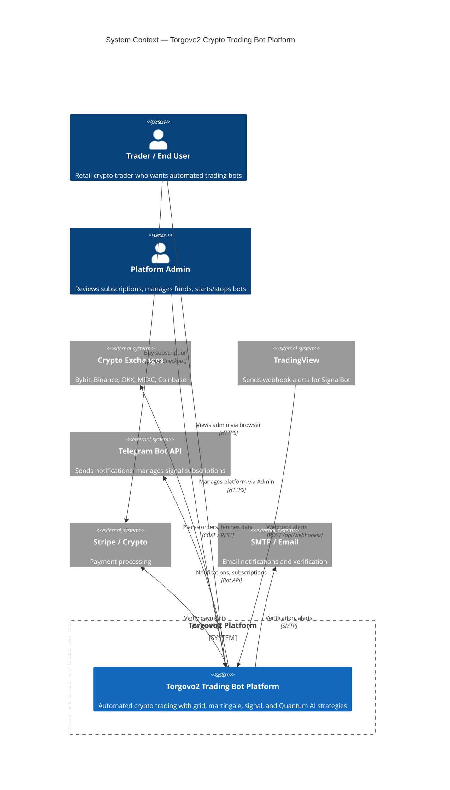
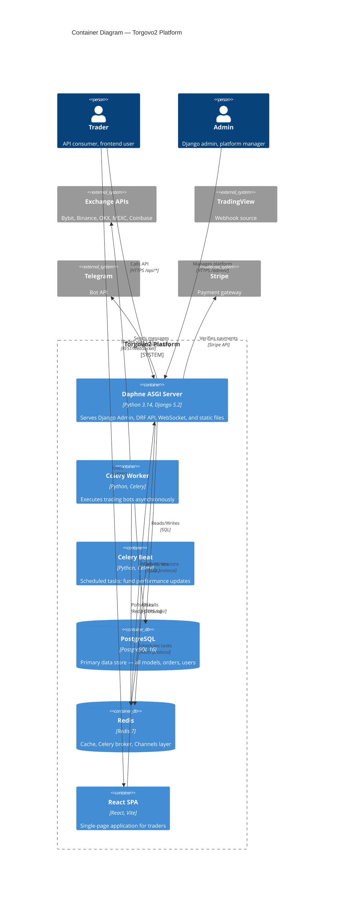
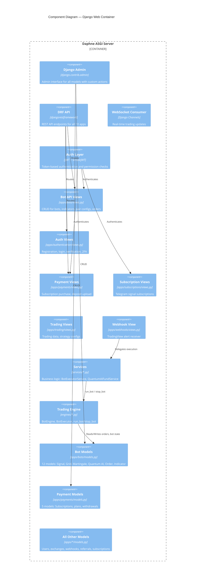
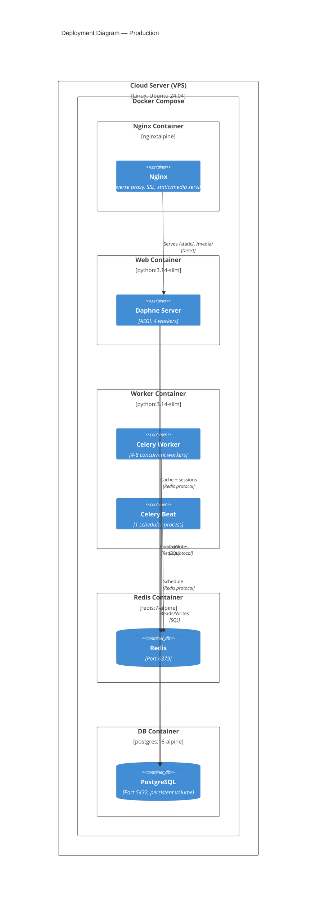

# C4 Architecture — Torgovo2 Trading Bot Platform

> C4 Model: Context → Container → Component. Level 4 (Code) is covered by the existing class/sequence diagrams.

---

## Level 1: System Context

---

## Level 2: Container Diagram

---

## Level 3: Component — Django Web Container

---

## Deployment Diagram (C4 Level 3)

