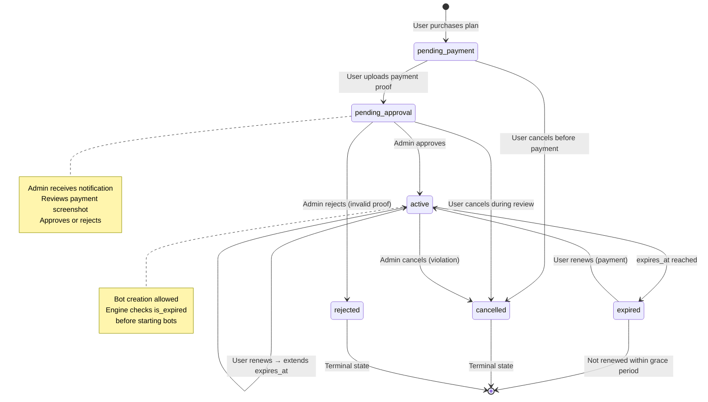
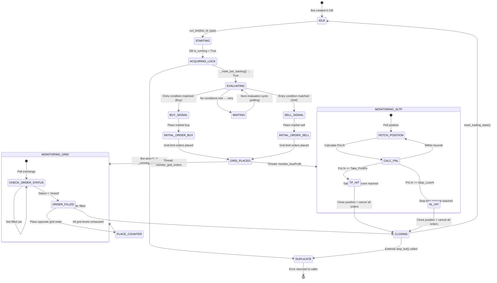
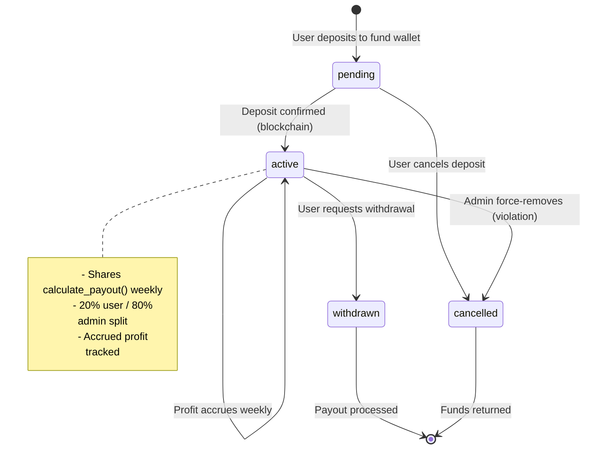
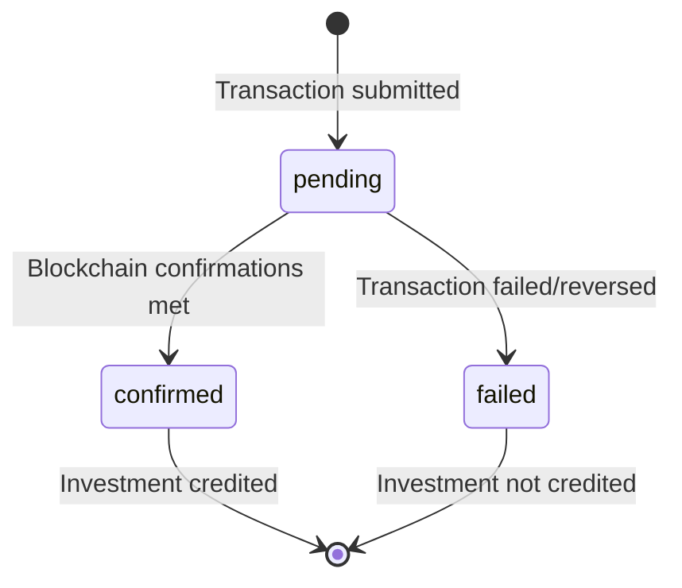
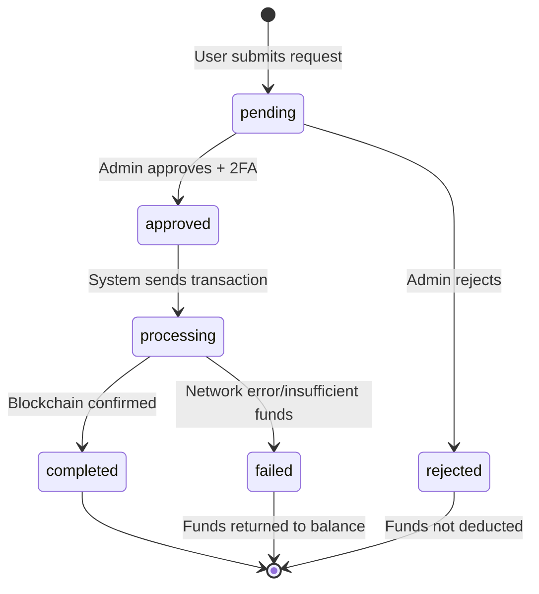
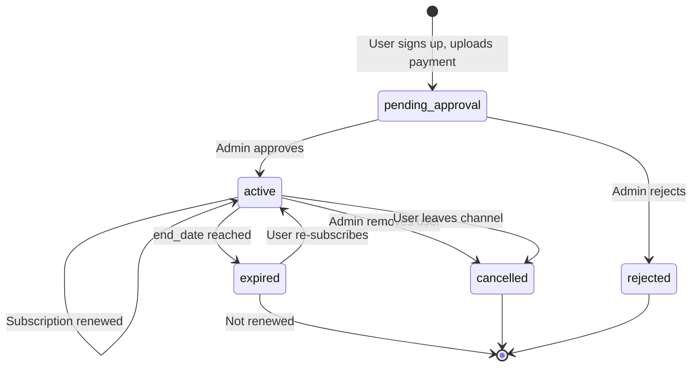
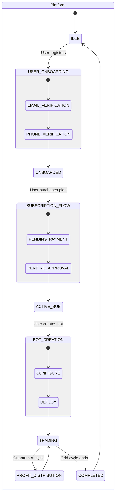

# State Machines — Torgovo2 Platform

---

## 1. BotSubscription Lifecycle (6 states)

### Transition Table

| From | To | Trigger | Guard | Actor |
|---|---|---|---|---|
| `[*]` | `pending_payment` | POST /api/payments/bot-subscriptions/ | None | User |
| `pending_payment` | `pending_approval` | Upload payment screenshot | File attached | User |
| `pending_payment` | `cancelled` | Cancel order | Within 24h | User |
| `pending_approval` | `active` | Admin approve | Screenshot valid, payment verified | Admin |
| `pending_approval` | `rejected` | Admin reject | Invalid/duplicate screenshot | Admin |
| `pending_approval` | `cancelled` | Cancel request | Before admin action | User |
| `active` | `expired` | Celery beat or access check | `now() > expires_at` | System |
| `active` | `cancelled` | Admin force-cancel | TOS violation | Admin |
| `active` | `active` | User renews | New payment successful | User + System |
| `expired` | `active` | User re-subscribes | New payment | User |

---

## 2. BotEngine Trading State Machine

---

## 3. Quantum AI Investment Status

---

## 4. QuantumDeposit Status

---

## 5. WithdrawalRequest Status

---

## 6. TelegramSubscription Status

---

## Composite: Full Platform State Space

