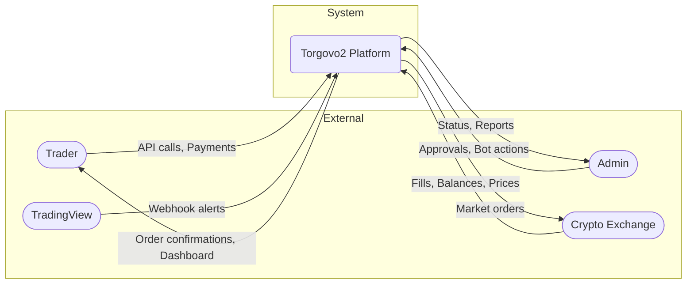
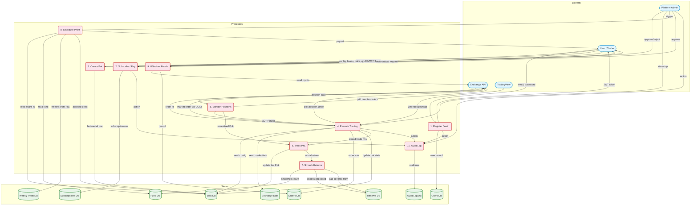
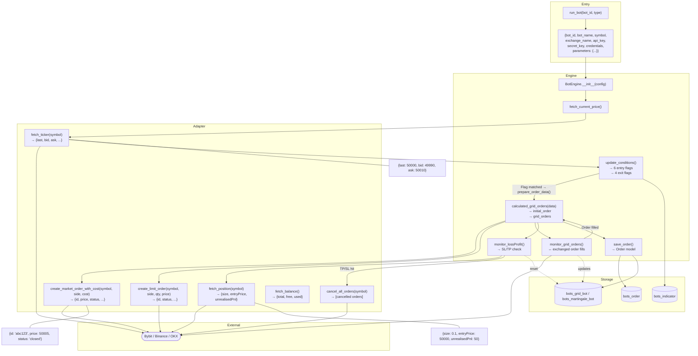

# Data Flow Diagram — Money & Order Flow

> Trace every path: how data, money, and orders move through the system. Critical for audit, compliance, and debugging.

---

## Legend

```
[External Entity]   (Process)           {Data Store}           ───►  Data Flow
   User            Execute Trade        PostgreSQL DB
```

---

## Level 0: Context DFD



---

## Level 1: Main Data Flows



---

## Level 2: Trading Execution Data Flow (Detailed)



---

## Level 2: Quantum AI Fund — Money Flow

```mermaid
flowchart TB
    subgraph "Inflows"
        DEPOSIT["User deposits USDT
                 to fund wallet"]
        TRADE_PROFIT["BotEngine generates
                      trading profit"]
    end

    subgraph "Fund"
        FUND_DB[(QuantumAIFund)]
        INV[(QuantumAIInvestment)]
    end

    subgraph "Smoothing Engine"
        CALC["calculate_smoothed_return()
              → min/max capped"]
        EXCESS["calculate_excess_return()
               → reserve deposit"]
        SHORTFALL["shortfall
                   → reserve withdraw"]
    end

    subgraph "Reserve"
        RESERVE_DB[(ReserveFund)]
    end

    subgraph "Outflows"
        USER_PROFIT["User profit share
                     → accrued_profit"]
        ADMIN_PROFIT["Admin fee (80%)"]
        PAYOUT["Process Payout
                → USDT to user"]
    end

    %% Primary Flow
    DEPOSIT --> FUND_DB
    FUND_DB --> INV
    TRADE_PROFIT --> CALC

    CALC -->|"actual > max"| EXCESS
    CALC -->|"actual < min"| SHORTFALL
    CALC -->|"min ≤ actual ≤ max"| USER_PROFIT

    EXCESS -->|deposit| RESERVE_DB
    SHORTFALL -->|withdraw| RESERVE_DB
    RESERVE_DB -->|cover gap| USER_PROFIT

    CALC --> ADMIN_PROFIT
    USER_PROFIT --> PAYOUT
    ADMIN_PROFIT --> FUND_DB

    PAYOUT -->|USDT sent| USER

    note right of EXCESS
        Excess = max(0, actual - max)
        Goes to reserve buffer
    end note

    note right of SHORTFALL
        Shortfall = max(0, min - actual)
        Reserve must can_cover()
        before withdrawal
    end note
```

---

## Data Dictionary — Key Flows

| Data Flow | Source | Target | Content | Frequency | Volume |
|---|---|---|---|---|---|
| `run_bot command` | Celery task | execution.run_bot() | `{bot_id, bot_type}` | On admin start | <1/sec |
| `config dict` | run_bot() | BotEngine.__init__() | `{symbol, api_key, parameters, ...}` | Per bot start | ~2KB |
| `market order` | BotEngine | Adapter → CCXT | `{symbol, side, amount, params}` | Per trade cycle | ~500B |
| `ticker data` | CCXT → Adapter | BotEngine | `{last, bid, ask, volume}` | Every evaluation cycle | ~200B |
| `order fill` | Exchange → CCXT | BotEngine.save_order() | `{id, price, qty, status, fee}` | Per trade | ~1KB |
| `fund update` | BotEngine | QuantumAIFundService | `{fund_id, new_total_value}` | Periodic (hourly) | ~500B |
| `smoothed return` | QuantumAIFundService | Django Admin display | `{monthly_return, floor, cap}` | Hourly | ~200B |
| `payout` | Admin action → Service | User wallet | `{user_id, amount, currency}` | Weekly | ~1KB |
| `subscription` | User → API → DB | BotSubscription | `{user_id, plan_id, status}` | One-time per purchase | ~500B |
| `webhook payload` | TradingView | apps/webhooks/views.py | `{bot_id, secret, side, qty, ...}` | On alert trigger | ~1KB |
| `audit log` | All processes | core_audit_log | `{action, resource, user, timestamp}` | On state change | ~500B |
