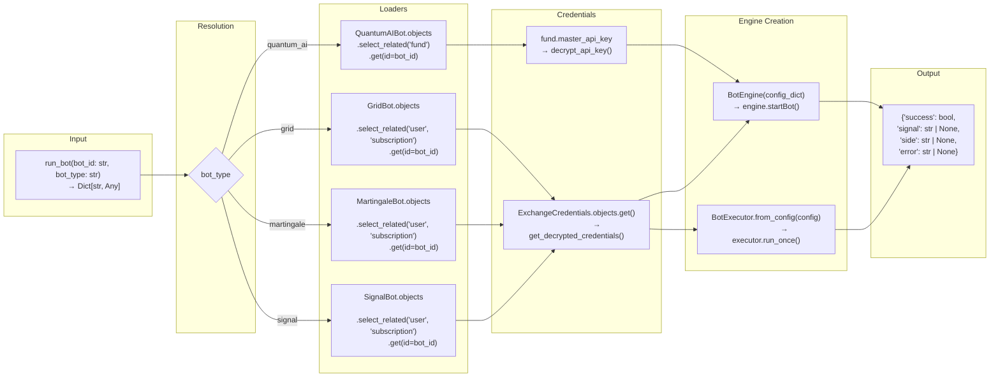

# Component / Interface Diagram — API Contracts

> Defines the public interfaces between Django apps: which view calls which service, what data crosses the boundary, and the contract format.

---

## 1. Inter-App Dependency Map

```mermaid
graph TB
    subgraph "API Entry Points"
        API["/api/* — DRF Router"]
        ADMIN["/admin/* — Django Admin"]
        WH["/api/webhooks/* — Webhook"]
    end

    subgraph "apps/bots"
        BV[bots/views.py]
        BA[bots/admin.py]
        BM[bots/models.py]
    end

    subgraph "apps/payments"
        PV[payments/views.py]
        PM[payments/models.py]
    end

    subgraph "apps/exchanges"
        EV[exchanges/views.py]
        EM[exchanges/models.py]
    end

    subgraph "apps/subscriptions"
        SV[subscriptions/views.py]
        SM[subscriptions/models.py]
    end

    subgraph "apps/trading"
        TV[trading/views.py]
        TE[engines/*.py]
        TS[strategies/*.py]
        TA[exchanges/*.py]
    end

    subgraph "services/"
        BES[bot_executor.py]
        QFS[quantum_ai_fund.py]
        SS[subscription_service.py]
    end

    subgraph "apps/users"
        UV[users/views.py]
        UM[users/models.py]
    end

    subgraph "apps/authentication"
        AV[auth/views.py]
        AM[auth/models.py]
    end

    subgraph "apps/webhooks"
        WV[webhooks/views.py]
    end

    subgraph "apps/investments"
        IV[investments/views.py]
        IM[investments/models.py]
    end

    subgraph "apps/referrals"
        RV[referrals/views.py]
        RM[referrals/models.py]
    end

    %% URL Routing
    API --> BV
    API --> PV
    API --> EV
    API --> SV
    API --> TV
    API --> UV
    API --> AV
    API --> IV
    API --> RV
    WH --> WV

    %% Admin routes
    ADMIN --> BA
    ADMIN --> PM

    %% Bot views → services
    BV --> BES
    BV --> QFS
    BV --> BM

    %% Trading views → engines
    TV --> TE

    %% Webhook → service
    WV --> BES

    %% Admin → services
    BA --> BES
    BA --> QFS
    BA --> TE

    %% Service → models
    BES --> BM
    BES --> EM
    BES --> PM
    QFS --> BM
    SS --> PM
    SS --> SM

    %% Engine → strategies + adapters
    TE --> TS
    TE --> TA
    TE --> BM
    TE --> EM

    %% Styles
    classDef entry fill:#e1f5fe,stroke:#0288d1,stroke-width:2px
    classDef view fill:#fff3e0,stroke:#f57c00,stroke-width:1px
    classDef service fill:#f3e5f5,stroke:#7b1fa2,stroke-width:2px
    classDef engine fill:#fce4ec,stroke:#c62828,stroke-width:2px
    classDef model fill:#e8f5e9,stroke:#388e3c,stroke-width:1px

    class API,ADMIN,WH entry
    class BV,PV,EV,SV,TV,UV,AV,WV,IV,RV,BA view
    class BES,QFS,SS service
    class TE,TS,TA engine
    class AM,BM,PM,EM,SM,UM,RM,IM model
```



---

## 2. Interface Contracts

### Interface 1: `BotExecutorService` (called by views + admin)

```mermaid
flowchart LR
    subgraph Callers
        BV["bots/views.py<br/>POST /api/bots/{type}/{id}/start/"]
        BA["bots/admin.py<br/>Admin start_bot action"]
    end

    subgraph Service
        BES["services/bot_executor.py"]
        BES_methods["start_grid_bot(user, bot_id)
        stop_grid_bot(user, bot_id)
        start_martingale_bot(user, bot_id)
        stop_martingale_bot(user, bot_id)
        execute_signal_bot_order(user, bot_id, payload)"]
    end

    subgraph Callees
        CELERY["Celery: run_trading_bot.delay()"]
        ENG["execution.run_bot()"]
        ADAPT["BaseAdapter.create_market_order()"]
    end

    BV -->|"POST {subscription_check}"| BES
    BA -->|"Admin action: bot_id"| BES
    BES -->|"delay(bot_id, 'grid')"| CELERY
    BES -->|"sync call for signals"| ENG
    BES -->|"direct CCXT for signals"| ADAPT

    %% Contract
    note left of BES
        Contract:
        Input:  user, bot_id
        Output: {"success": bool,
                 "error": str | None}
        Throws: PermissionError
                SubscriptionExpired
                BotNotFound
    end note
```

---

### Interface 2: `run_bot()` — The Main Orchestrator



---

### Interface 3: Strategy Contract (Input/Output)

```mermaid
flowchart TB
    subgraph "Input to strategy.execute()"
        MARKET_DATA["market_data: {
            ticker: {last, bid, ask, high, low, volume},
            ohlcv: [{timestamp, open, high, low, close, volume}],
            orderbook: {bids: [[price, size]], asks: [[price, size]]}
        }"]
        ACCOUNT["account_info: {
            total_balance: float,
            free_balance: float,
            used_balance: float
        }"]
        POSITION["current_position: {
            side: 'long' | 'short' | None,
            size: float,
            entry_price: float,
            unrealized_pnl: float
        }"]
    end

    subgraph "Strategy.execute()"
        BASE["BaseStrategy.execute(market_data, account_info, current_position)
             → Optional[Signal]"]
    end

    subgraph "Output: Signal"
        SIGNAL["@dataclass Signal {
            action: 'buy' | 'sell' | 'close' | 'hold',
            symbol: str,
            amount: float,
            price: float | None,
            order_type: 'market' | 'limit',
            stop_loss: float | None,
            take_profit: float | None,
            reason: str | None,
            metadata: dict | None
        }"]
    end

    MARKET_DATA --> BASE
    ACCOUNT --> BASE
    POSITION --> BASE
    BASE --> SIGNAL

    note left of BASE
        Pure Python — no Django imports.
        No exchange calls.
        No I/O.
        Deterministic given same inputs.
    end note
```

---

### Interface 4: Adapter Contract (Input/Output)

```mermaid
flowchart LR
    subgraph "Adapter Methods"
        TICK["fetch_ticker(symbol: str)
             → Dict{last, bid, ask, high, low, volume}"]
        OHLCV["fetch_ohlcv(symbol, timeframe, limit)
              → List[{timestamp, open, high, low, close, volume}]"]
        ORDER_BOOK["fetch_order_book(symbol, limit)
                   → {bids: [[p, s]], asks: [[p, s]]}"]
        MKT["create_market_order(symbol, side, amount, params)
            → Dict{id, symbol, price, status, filled, cost}"]
        LIMIT["create_limit_order(symbol, side, amount, price, params)
              → Dict{id, symbol, price, status, ...}"]
        MKT_COST["create_market_order_with_cost(symbol, side, cost, params)
                → Dict{id, symbol, cost, price, ...}"]
        POS["fetch_position(symbol)
            → Dict{size, entryPrice, unrealisedPnl, liquidationPrice}"]
        CANCEL["cancel_all_orders(symbol)
              → List[Dict{id, symbol, status}]"]
        BAL["fetch_balance()
            → Dict{total: float, free: float, used: float}"]
    end

    subgraph "Normalization"
        NORM["All adapters normalize
              exchange-specific CCXT output
              → standardized dict shape"]
    end

    TICK --> NORM
    OHLCV --> NORM
    MKT --> NORM
    LIMIT --> NORM
    POS --> NORM

    note right of NORM
        Bybit: position = {size: 0.1, ...}
        Binance: position = {positionAmt: 0.1, ...}
        ↓
        Adapter standardizes to:
        {size: 0.1, entryPrice: ..., ...}
        BotEngine never sees raw CCXT.
    end note
```

---

### Interface 5: Admin Action → Engine (Django Admin Contract)

```mermaid
flowchart TB
    subgraph "Admin Actions"
        START_GRID["Admin: Start GridBot"]
        STOP_GRID["Admin: Stop GridBot"]
        START_MART["Admin: Start MartingaleBot"]
        STOP_MART["Admin: Stop MartingaleBot"]
        START_QAI["Admin: Start QuantumAIBot"]
        STOP_QAI["Admin: Stop QuantumAIBot"]
        CALC_DIST["Admin: Calculate Profit Distribution"]
        PROC_PAY["Admin: Process Payouts"]
    end

    subgraph "Handler"
        ACTIONS["bots/admin.py
                 ModelAdmin.actions"]
    end

    subgraph "Dispatcher"
        SERV["services/bot_executor.py"]
        FUND["services/quantum_ai_fund.py"]
        ENG["engines/execution.py"]
    end

    subgraph "Async"
        CELERY["Celery Worker"]
    end

    START_GRID --> ACTIONS
    STOP_GRID --> ACTIONS
    START_MART --> ACTIONS
    STOP_MART --> ACTIONS
    START_QAI --> ACTIONS
    STOP_QAI --> ACTIONS
    CALC_DIST --> ACTIONS
    PROC_PAY --> ACTIONS

    ACTIONS --> SERV
    ACTIONS --> FUND
    ACTIONS --> ENG

    SERV -->|"delay()"| CELERY
    CELERY -->|"run_bot() or stop_bot()"| ENG

    note left of ACTIONS
        Each action receives:
        request, queryset

        Calls the appropriate
        service method.
        Shows message on success/failure.
    end note
```

---

## 3. API Endpoint Contract Summary

| Method | Endpoint | App | Calls Service | Auth | Rate Limited |
|---|---|---|---|---|---|
| POST | `/api/auth/register/` | auth | — | None | Yes |
| POST | `/api/auth/login/` | auth | — | None | Yes |
| GET | `/api/bots/grid-bots/` | bots | — | JWT | Yes |
| POST | `/api/bots/grid-bots/` | bots | — | JWT+sub | Yes |
| POST | `/api/bots/grid-bots/{id}/start/` | bots | `BotExecutorService.start_grid_bot()` | JWT+sub | No |
| POST | `/api/bots/grid-bots/{id}/stop/` | bots | `BotExecutorService.stop_grid_bot()` | JWT+sub | No |
| POST | `/api/webhooks/custombot/` | webhooks | `BotExecutorService.execute_signal_bot_order()` | webhook_secret | Yes |
| POST | `/api/payments/bot-subscriptions/` | payments | — | JWT | Yes |
| POST | `/api/payments/bot-subscriptions/{id}/approve/` | payments | — | Admin | No |
| POST | `/api/payments/withdrawals/` | payments | — | JWT+2FA | Yes |
| POST | `/api/subscriptions/telegram/` | subscriptions | — | JWT | Yes |
| GET | `/api/exchanges/trading-pairs/` | exchanges | — | JWT | Yes |
| POST | `/api/users/profile/` | users | — | JWT | Yes |
| GET | `/api/referrals/` | referrals | — | JWT | Yes |

---

## 4. Event / Message Contracts (Celery)

| Task | Queue | Input | Output | Scheduled |
|---|---|---|---|---|
| `run_trading_bot` | `trading` | `{bot_id: str, bot_type: str}` | `{success: bool, ...}` | On demand |
| `stop_bot` | `trading` | `{bot_id: str, bot_type: str}` | `{success: bool}` | On demand |
| `update_fund_performance` | `fund` | `{fund_id: str}` | `{smoothed_return: float}` | Celery Beat (hourly) |
| `calculate_profit_distribution` | `fund` | `{fund_id: str}` | `{distributed_to: int}` | Celery Beat (weekly) |
| `process_withdrawal` | `payments` | `{withdrawal_id: str}` | `{tx_hash: str, status: str}` | On demand |

---

## 5. Key Interface Rules

```mermaid
flowchart TB
    R1["R1: Views NEVER call engine directly.
        Always go through services/ layer."]
    R2["R2: Strategies NEVER import Django models
        OR call exchange APIs. Pure Python only."]
    R3["R3: Adapters NEVER use Django.
        Wrapped CCXT only."]
    R4["R4: Engines (BotEngine, BotExecutor)
        are the ONLY place Django + Pure Python mix."]
    R5["R5: run_bot() is the single entry point
        for all Celery trading tasks."]
    R6["R6: All inter-app references go through
        Django model imports, never raw SQL."]
    R7["R7: API key decryption happens ONLY
        inside run_bot(), never in strategies/adapters."]

    style R1 fill:#ffcdd2,stroke:#c62828
    style R2 fill:#ffcdd2,stroke:#c62828
    style R3 fill:#ffcdd2,stroke:#c62828
    style R4 fill:#fff9c4,stroke:#f9a825
    style R5 fill:#e1f5fe,stroke:#0288d1
    style R6 fill:#e8f5e9,stroke:#388e3c
    style R7 fill:#fce4ec,stroke:#b71c1c
```


