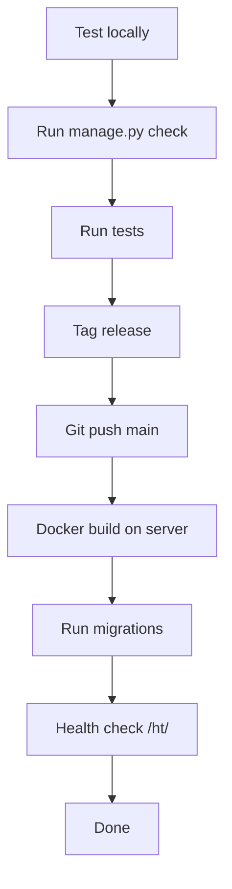

# Standard Operating Procedures

## 1. Deploy Production



### Steps
1. `python manage.py check --deploy`
2. `python manage.py test`
3. `git tag vX.Y.Z && git push --tags`
4. `git push origin main`
5. On server: `docker-compose pull && docker-compose up -d --build`
6. `docker-compose exec web python manage.py migrate`
7. Verify `GET /ht/` returns all services green
8. Verify Sentry shows no new errors after 5 minutes

---

## 2. Incident Response

### Severity Levels
| Level | Definition | Response Time |
|-------|-----------|---------------|
| SEV1 | Trading engine down, users losing money | < 15 min |
| SEV2 | Payment/API degraded, non-critical | < 1 hr |
| SEV3 | Minor bug, cosmetic issue | < 24 hr |

### SEV1 Response
1. Acknowledge in Slack #incidents
2. Assess impact (which users, which exchanges, how many bots)
3. If trading engine is affected: pause all active bots
   - Celery: `celery -A config control shutdown`
   - Admin panel: bulk stop active bots
4. Investigate root cause (check Sentry, check logs)
5. Apply fix or rollback (`docker-compose down && docker-compose up -d --build`)
6. Verify fix
7. Resume bots (Celery: `celery -A config worker -l info -B`)
8. Post-incident review within 24h

### SEV2 Response
1. Log in issue tracker
2. Investigate within 1 hr
3. Fix within same day or schedule
4. Deploy fix via normal deploy cycle

---

## 3. User Data Deletion (GDPR)

1. Receive deletion request → create support ticket
2. Verify identity (email confirmation)
3. Run management command: `python manage.py delete_user_data <user_id>`
   - Deletes: profile, credentials, bots, orders, transactions, logs
   - Retains: anonymized referral rewards (legal requirement)
4. Confirm deletion to user
5. Log in audit system (ticket ID, date, admin who processed)
6. Time: within 30 days (GDPR Art. 12)

---

## 4. Deposit Approval

1. User submits deposit via `POST /api/payments/deposits/`
2. Admin sees pending deposit in admin dashboard
3. Admin verifies on-chain transaction (blockchain explorer)
4. Admin calls `POST /api/payments/deposits/{id}/confirm/`
5. System credits user balance
6. Notification sent to user (email)
7. If unreachable after 24h → auto-reject

---

## 5. Exchange Key Rotation (Admin)

1. Generate new exchange API key on exchange dashboard
2. Update environment variable: `EXCHANGE_MASTER_KEY`, `EXCHANGE_MASTER_SECRET`
3. Run `python manage.py encrypt_quantum_fund_keys`
4. Verify test: `POST /api/exchanges/credentials/{id}/test/`
5. Revoke old key on exchange
6. Log in admin audit

---

## 6. Database Backup & Restore

### Backup
```bash
docker-compose exec postgres pg_dump -U postgres torgovo > backup_$(date +%Y%m%d).sql
```

### Restore (test monthly)
```bash
docker-compose exec postgres psql -U postgres -c "DROP DATABASE torgovo;"
docker-compose exec postgres psql -U postgres -c "CREATE DATABASE torgovo;"
cat backup_latest.sql | docker-compose exec -T postgres psql -U postgres torgovo
```

---

## 7. Celery Task Monitoring

```bash
# Check worker status
celery -A config status

# Inspect active tasks
celery -A config inspect active

# Inspect reserved (queued) tasks
celery -A config inspect reserved

# Purge all tasks
celery -A config purge -f

# Restart worker
docker-compose restart celery-worker
```

---

## 8. New Developer Onboarding

1. Follow `docs/SETUP.md`
2. Run full test suite: `python manage.py test`
3. Review `docs/ARCHITECTURE.md`
4. Review `docs/CODEBASE.md` known issues
5. Create admin user + test bot on Binance testnet
6. Pair with existing developer for first 3 days
7. Install pre-commit hooks: `pre-commit install`
